# tidydiversity <a href="https://jmozez.github.io/tidydiversity/"></a>

<!-- badges: start -->

[](https://github.com/jmozez/tidydiversity/actions/workflows/R-CMD-check.yaml)
[](https://github.com/jmozez/tidydiversity/actions/workflows/test-coverage.yaml)
[](https://github.com/jmozez/tidydiversity/actions/workflows/lint.yaml)
[](https://jmozez.github.io/tidydiversity/)
[](https://lifecycle.r-lib.org/articles/stages.html#experimental)
[](https://github.com/jmozez/tidydiversity/blob/main/LICENSE.md)
<!-- badges: end -->

<div class="td-hero">

**Taxonomic, phylogenetic and functional diversity on one scale, in one
tidy workflow.**

Reviewers increasingly expect taxonomic (TD), phylogenetic (PD) and
functional (FD) diversity to be reported together and to be comparable.
tidydiversity expresses all three as Hill numbers of the same order q,
in units of effective numbers of species, and standardises them by
sample size or sample coverage. Data go in as a long data frame and
results come back as tibbles.

</div>

> **In memory of Filip Damen (about 1966-2026).** tidydiversity is
> dedicated to the Wanang leader who refused the loggers, kept his
> forest for science, and built a research station, a school and a
> health post with his community. The `wanang_butterflies` data come
> from the forest he protected. [Read his
> story](https://jmozez.github.io/tidydiversity/articles/filip-damen.html).

<div class="td-cards">

<div class="td-card">

### Taxonomic (TD)

Species counts only. Observed and asymptotic Hill numbers, sample
coverage, rarefaction and extrapolation, matching iNEXT.

</div>

<div class="td-card">

### Phylogenetic (PD)

Add a phylogeny with `type = "PD", tree = tree`. Effective number of
lineages at a reference time, matching iNEXT.3D.

</div>

<div class="td-card">

### Functional (FD)

Add a trait distance matrix with `type = "FD", distance = d`. Effective
number of functionally distinct species at a threshold tau, or the area
under the tau profile, matching iNEXT.3D.

</div>

</div>

## Why tidydiversity?

Community ecology in R is spread over many packages: iNEXT and iNEXT.3D
for Hill numbers, vegan for ordination and permutation tests, betapart
for beta diversity, FD, TPD, ade4 and phytools for traits and
phylogenies. Each has its own input format (wide matrices, lists, row
names) and its own output (lists, S4 objects, printed tables). Most of
an analysis ends up as glue code: reshaping data frames by hand,
matching species names across matrices, pulling numbers out of nested
lists, and re-drawing every plot. tidydiversity replaces that glue with
one consistent, tested interface.

### One workflow instead of hand-rolled glue

| You usually hand-roll                                                                 | With tidydiversity                                                                     |
|---------------------------------------------------------------------------------------|----------------------------------------------------------------------------------------|
| Pivot long field data to a site x species matrix, align row names with the site table | Long data in, one row per site and species: `div_hill(data, site, species, abundance)` |
| Match species names between the community matrix, the trait table and the tree        | Matched and checked for you, with a clear error naming the missing species             |
| Loop over seasons or treatments and bind the results                                  | `.by = season`, or `group_by()`                                                        |
| Dig estimates out of iNEXT, vegan or FD list objects                                  | Every result is a tibble; `tidy()` and `glance()` for models                           |
| Rebuild CANOCO-style biplots, rarefaction curves and multi-panel figures              | `autoplot()`, `plot_panel()`, `plot_save()` at journal sizes                           |
| Write permutation tests for CWM, null models, forward selection                       | `trait_cwm_test()` (max test), `trait_ses()`, `ord_select()`                           |
| Feed diversity into tidymodels with leakage-free resampling                           | `model_group_folds()`, `model_case_weights()`, `step_hill()`                           |

### Gaps it fills

- **TD, PD and FD on one scale.** Taxonomic, phylogenetic and functional
  Hill numbers of the same order q, in effective numbers of species,
  standardised by sample size or coverage (Chao et al. 2014, 2019).
- **Beta diversity at equal coverage.** Gamma, alpha and beta Hill
  numbers and four normalised dissimilarities for TD, PD and FD,
  standardised to a common sample coverage with bootstrap intervals
  (`beta_hill()`, Chao et al. 2023), so regions sampled with unequal
  effort can be compared.
- **Current, accepted methods.** The max test for community-weighted
  means (Zeleny 2018), forward selection with double stopping (Blanchet
  et al. 2008), adjusted R² variation partitioning, trait probability
  densities (Carmona et al. 2019), gawdis trait distances (de Bello et
  al. 2021), Rao partitioning in equivalent numbers, and the full trait
  workflow of the *Handbook of Trait-Based Ecology*.
- **Statistics that respect the design.** Restricted permutations within
  blocks, a Welch-type PERMANOVA that stays valid when groups differ in
  spread (`beta_welch()`, Hamidi et al. 2019), site-blocked
  cross-validation, and precision weights from estimation error.
- **Publication output.** CANOCO-style biplots and triplots with
  ellipses, hulls and spiders; consistent colour-blind-safe themes on
  white backgrounds; multi-panel figures with panel tags.
- **Geospatial and ForestGEO in one tidy workflow.** Study-site maps,
  basemaps, vector/raster verbs, WorldClim/CHELSA bioclim (including
  CHELSA-CMIP6), stem maps on topography, census demography, dbMEM,
  spatial rarefaction, grain helpers, mid-domain nulls, and tidy SDMs
  (`sdm_*`) that never send you to biomod2 or Java Maxent.
- **Partial effects without package-hopping.** `plot_partial()` and
  `plot_surface()` replace the visreg / plotmo jump in Moses et al.
  (2021); `model_count()` covers overdispersed counts without aods3.

### Fast where it matters

Hot loops are rewritten as compiled C++ (Rcpp) kernels or as vectorised
matrix algebra. Every rewrite is tested against the reference package
and gives identical results. Timings on one CPU core, with the Brazil
rainforest data of iNEXT.3D (3868 individuals, 425 species, 40 sample
sizes) and the DaPhnE tree (1641 species):

| Task                                 | Before                 | tidydiversity  | How                                   |
|--------------------------------------|------------------------|----------------|---------------------------------------|
| PD rarefaction and extrapolation     | 3.9 s                  | 0.4 s          | C++ hypergeometric kernel             |
| FD rarefaction and extrapolation     | 3.6 s (iNEXT.3D)       | 0.2 s          | C++ kernel                            |
| Blomberg’s K with 999 randomisations | 4.4 s per K (phytools) | 1.5 s in total | contrasts with precomputed tree terms |
| Community TPDs and TPD indices       | 2.5 s (TPD)            | \< 0.1 s       | matrix algebra                        |

Optional packages (vegan, FD, ade4, TPD, phytools, tidymodels) load only
when a function needs them, so `library(tidydiversity)` stays light.

### Made for the tidyverse

- **Tidy in, tidy out.** One row per site and species goes in, a tibble
  comes out, ready for dplyr, tidyr and ggplot2.
- **Data-masking.** Name your columns with `site`, `species` and
  `abundance`, as you would in dplyr.
- **Grouping.** Every verb takes `.by` and respects `group_by()`.
- **broom and tidymodels.** `tidy()` and `glance()` methods, a recipes
  step, and rsample folds.
- **ggplot2.** `autoplot()` returns ordinary ggplot objects you can
  extend with `+`; patchwork composes them.
- **Predictable names.** Functions are grouped by prefix: `div_` (alpha
  diversity), `beta_`, `ord_`, `trait_`, `phylo_`, `model_`, `geo_`,
  `stems_`, `sdm_` and `plot_`.
- **Checked.** Results match iNEXT, iNEXT.3D, betapart, vegan, FD, ade4,
  iNEXT.beta3D, indicspecies, TPD and phytools in more than 400 tests.

### What one package covers

| Topic                                                                                     | tidydiversity                                                                            | Usually needs                           |
|-------------------------------------------------------------------------------------------|------------------------------------------------------------------------------------------|-----------------------------------------|
| Hill numbers, coverage, rarefaction/extrapolation (TD, PD, FD)                            | `div_*()`                                                                                | iNEXT, iNEXT.3D, hillR                  |
| Beta diversity partitioning, distance decay and decay models                              | `beta_pair()`, `beta_multi()`, `beta_decay()`, `beta_decay_model()`                      | betapart                                |
| Pairwise Hill-number dissimilarity (Sorensen, Jaccard, Horn, Morisita-Horn)               | `beta_hill_pair()`                                                                       | vegan                                   |
| Coverage-standardised beta diversity (TD, PD, FD)                                         | `beta_hill()`                                                                            | iNEXT.beta3D                            |
| Ordination (PCA to db-RDA) with biplots                                                   | `ord_fit()`, `autoplot()`                                                                | vegan, ggvegan, ggord                   |
| PERMANOVA (classic and Welch-type), dispersion, variation partitioning, forward selection | `beta_permanova()`, `beta_welch()`, `beta_dispersion()`, `ord_varpart()`, `ord_select()` | vegan, adespatial                       |
| Indicator species, corrected for multiple testing                                         | `beta_indicator()`                                                                       | indicspecies                            |
| Traits: CWM, FD indices, null models, ITV, fourth corner                                  | `trait_*()`                                                                              | FD, gawdis, picante, cati, ade4, weimea |
| Trait probability densities                                                               | `trait_tpd()`                                                                            | TPD                                     |
| Phylogenetic signal and distances                                                         | `phylo_*()`                                                                              | phytools, picante, ape                  |
| Modelling with tidymodels                                                                 | `model_*()`, `step_hill()`                                                               | hand-written glue                       |
| Geospatial sites, basemaps, GADM, GDAL I/O, maps | `geo_*()`, `geo_read()`/`geo_write()`, `geo_save()`, `plot_sites()`, `plot_geo()` | sf, terra, maptiles, geodata |
| ForestGEO stems and topography                                                            | `stems_*()`, `plot_topo()`                                                               | fgeo, CTFS R package                    |
| Species distribution models (tidy)                                                        | `sdm_fit()`, `sdm_predict()`, `plot_sdm()`                                               | biomod2, dismo, maxnet                  |
| Partial-effect and surface plots; overdispersed counts                                    | `plot_partial()`, `plot_surface()`, `model_count()`                                      | visreg, plotmo, aods3                   |
| Publication figures and tables                                                            | `autoplot()`, `plot_*()`, `div_table()`                                                  | ggplot2, patchwork, gt                  |

## Installation

Install the development version from GitHub:

``` r
# install.packages("pak")
pak::pak("jmozez/tidydiversity")
```

## Example

`png_ants` records ground-foraging ants at nutrient baits along the Mt
Wilhelm elevational gradient in Papua New Guinea, in the dry and the wet
season (Moses et al. 2023). Each row is one species at one bait, so
diversity is estimated from the number of baits at which each species
was found.

``` r
library(tidydiversity)
library(dplyr)

div_hill(png_ants, q = c(0, 1, 2), .by = season)
#> # A tibble: 30 x 5
#>    season site       q     n diversity
#>    <chr>  <chr>  <dbl> <dbl>     <dbl>
#>  1 dry    MW0200     0    47     16   
#>  2 dry    MW0200     1    47     12.3 
#>  3 dry    MW0200     2    47      9.91
#>  4 wet    MW0200     0    76     21   
#>  5 wet    MW0200     1    76     10.9 
#>  6 wet    MW0200     2    76      6.99
#>  7 dry    MW0700     0    23     15   
#>  8 dry    MW0700     1    23     11.8 
#>  9 dry    MW0700     2    23      8.67
#> 10 wet    MW0700     0    58     28   
#> # i 20 more rows
```

Compare sites at equal sample completeness. By default each season is
standardised to the lowest coverage that all its sites reach at twice
their sample size, so no site is extrapolated too far:

``` r
set.seed(1)
div_standardise(png_ants, .by = season, nboot = 50) |>
  filter(q == 0)
#> # A tibble: 10 x 10
#>    season site       q      m method        coverage diversity    se lower upper
#>    <chr>  <chr>  <dbl>  <dbl> <chr>            <dbl>     <dbl> <dbl> <dbl> <dbl>
#>  1 dry    MW0200     0  11.6  rarefaction      0.565      7.96 0.458  7.07  8.86
#>  2 wet    MW0200     0  45.1  rarefaction      0.796     15.7  1.42  12.9  18.4 
#>  3 dry    MW0700     0  46.0  extrapolation    0.565     26.0  5.31  15.6  36.4 
#>  4 wet    MW0700     0 116    extrapolation    0.796     42.2  6.36  29.8  54.7 
#>  5 dry    MW1200     0  11.0  rarefaction      0.565      7.17 0.669  5.86  8.48
#>  6 wet    MW1200     0  40.6  rarefaction      0.796     17.1  1.82  13.5  20.6 
#>  7 dry    MW1700     0   3.07 rarefaction      0.565      2.32 0.226  1.88  2.77
#>  8 wet    MW1700     0  25.4  rarefaction      0.796      8.36 1.58   5.26 11.5 
#>  9 dry    MW2200     0   4.76 rarefaction      0.565      3.48 0.363  2.77  4.20
#> 10 wet    MW2200     0   8.97 rarefaction      0.796      4.01 0.585  2.86  5.15
```

## Example data from Papua New Guinea

Every example uses published field data, rebuilt from the original
deposits by scripts in `data-raw/`.

| Dataset              | What it holds                                                      | Source                                                                                                            |
|----------------------|--------------------------------------------------------------------|-------------------------------------------------------------------------------------------------------------------|
| `png_ants`           | Ants at nutrient baits, Mt Wilhelm, 200-3700 m, dry and wet season | Moses et al. (2023) *Global Ecology and Biogeography*, [doi:10.1111/geb.13757](https://doi.org/10.1111/geb.13757) |
| `png_tree_ants`      | Every ant nest in 1254 trees at 200, 900 and 1800 m                | Plowman et al. (2020) *Ecography*, [doi:10.1111/ecog.04730](https://doi.org/10.1111/ecog.04730)                   |
| `png_frogs`          | 3390 frogs of 55 species at eight elevations, Mt Wilhelm           | Dahl et al. (2023) *Biotropica*, [doi:10.1111/btp.13283](https://doi.org/10.1111/btp.13283)                       |
| `wanang_butterflies` | Butterflies on 36 days over three years, Wanang forest plot        | Luk et al. (2019) *Biotropica*, [doi:10.1111/btp.12671](https://doi.org/10.1111/btp.12671)                        |
| `wanang_caterpillars` | 9363 reared caterpillars of 849 morphospecies, primary and secondary forest at Wanang | Butterill and Redmond (2023) GBIF, [doi:10.15468/7e96ht](https://doi.org/10.15468/7e96ht) (CC BY 4.0) |

## TD, PD and FD on one scale

The same verbs give all three dimensions. Here are rarefaction and
extrapolation curves for two Brazilian rainforest tree assemblages,
using the abundance data, phylogeny and functional distances shipped
with iNEXT.3D.

``` r
library(ggplot2)
data(list = c(
  "Brazil_rainforest_abun_data", "Brazil_rainforest_phylo_tree",
  "Brazil_rainforest_distance_matrix"
), package = "iNEXT.3D")
wide <- Brazil_rainforest_abun_data
brazil <- tibble(
  site = rep(colnames(wide), each = nrow(wide)),
  species = rep(rownames(wide), ncol(wide)),
  n = unlist(wide, use.names = FALSE)
) |>
  filter(n > 0)

curves <- bind_rows(
  div_rarefy(brazil, abundance = n, type = "TD") |> mutate(type = "TD"),
  div_rarefy(brazil,
    abundance = n, type = "PD",
    tree = Brazil_rainforest_phylo_tree
  ),
  div_rarefy(brazil,
    abundance = n, type = "FD",
    distance = as.matrix(Brazil_rainforest_distance_matrix)
  )
)

curves$type <- factor(curves$type, levels = c("TD", "PD", "FD"))

ggplot(curves, aes(m, diversity, colour = site)) +
  geom_line(aes(linetype = method == "extrapolation")) +
  geom_point(data = filter(curves, method == "observed"), size = 2) +
  facet_wrap(vars(q, type),
    ncol = 3, scales = "free_y",
    labeller = labeller(q = function(x) paste("q =", x), .multi_line = FALSE)
  ) +
  scale_linetype_manual(values = c("solid", "dashed"), guide = "none") +
  labs(
    x = "Number of individuals",
    y = "Effective number of species", colour = NULL
  ) +
  theme_tidydiversity()
```

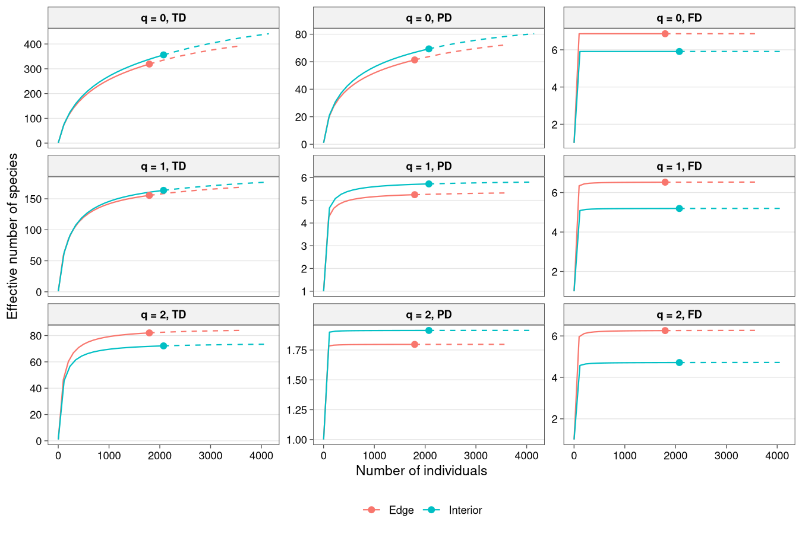

### Why one scale?

Hill numbers of order q share one unit, the effective number of equally
abundant (and, for PD and FD, equally distinct) species, so TD, PD and
FD of the same order can be compared directly, and their ratios read as
measures of phylogenetic or functional redundancy (Chao, Chiu and Jost
2014,
[doi:10.1146/annurev-ecolsys-120213-091540](https://doi.org/10.1146/annurev-ecolsys-120213-091540);
Chao et al. 2019,
[doi:10.1002/ecm.1343](https://doi.org/10.1002/ecm.1343)). Standardising
every dimension by the same sample size or coverage removes the effect
of unequal sampling effort before you compare sites.

## Functions

| Family                     | Functions                                                                                                                                                                                          |
|----------------------------|----------------------------------------------------------------------------------------------------------------------------------------------------------------------------------------------------|
| Community data             | `as_community()`, `community_wide()`, `community_long()`, `add_site_data()`                                                                                                                        |
| Alpha diversity (`div_`)   | `div_hill()`, `div_estimate()`, `div_coverage()`, `div_rarefy()`, `div_standardise()`, `div_completeness()`, `div_evenness()`, `div_boot()`                                                        |
| Beta diversity (`beta_`)   | `beta_pair()`, `beta_multi()`, `beta_hill()`, `beta_hill_pair()`, `beta_decay()`, `beta_decay_model()`, `beta_dist()`, `beta_permanova()`, `beta_welch()`, `beta_dispersion()`, `beta_indicator()` |
| Ordination (`ord_`)        | `ord_fit()`, `ord_test()`, `ord_select()`, `ord_varpart()`                                                                                                                                         |
| Traits (`trait_`)          | `trait_dist()`, `trait_cwm()`, `trait_cwm_test()`, `trait_fd_indices()`, `trait_rao()`, `trait_ses()`, `trait_itv()`, `trait_fourth_corner()`, `trait_tpd()`, `trait_tpd_dissim()`                 |
| Phylogeny (`phylo_`)       | `phylo_signal()`, `phylo_dist()`, `phylo_combine_dist()`                                                                                                                                           |
| Modelling (`model_`)       | `model_group_folds()`, `model_case_weights()`, `step_hill()`, `tidy()`, `glance()`                                                                                                                 |
| Geospatial (`geo_`)        | `geo_as_sf()`, `geo_extract()`, `geo_clean()`, `geo_gbif()`, `geo_distance()`, `geo_decay()`, `geo_basemap()`, `geo_bioclim()`, `geo_worldclim()`, `geo_chelsa()`, `geo_elevation()`, `geo_mem()`, `geo_rarefy_spatial()`, `geo_grain()`, `geo_middomain()`, `geo_moran()`, `geo_as_features()`, `as_sf()`, `as_spat_raster()`, vector/raster verbs |
| ForestGEO (`stems_`)       | `stems_as_trees()`, `stems_quadrat()`, `stems_abundance()`, `stems_basal_area()`, `stems_size_class()`, `stems_demography()`, `stems_habitat()`, `stems_habitat_test()`, `stems_as_community()`, `stems_neighbours()` |
| SDM (`sdm_`)               | `sdm_fit()`, `sdm_predict()`, `sdm_evaluate()`, `plot_sdm()`                                                                                                                                       |
| Count / partial plots      | `model_count()`, `plot_partial()`, `plot_surface()`                                                                                                                                                |
| Plots and tables (`plot_`) | `autoplot()`, `plot_panel()`, `plot_save()`, `plot_palette()`, `plot_sites()`, `plot_geo()`, `plot_topo()`, `plot_partial()`, `plot_surface()`, `plot_phylo()`, `plot_trait_space()`, `plot_venn()`, `theme_tidydiversity()`, `div_table()` |
| Example data               | `png_ants`, `png_tree_ants`, `png_frogs`, `wanang_butterflies`, `wanang_caterpillars`, `data_aravo()`, `geo_example_sites()`, `geo_example_stems()`, `geo_example_dem()`, `geo_example_censuses()` |


## Gallery

Every plot that `autoplot()` draws, using `png_ants`.

### Rarefaction and extrapolation by sample size

Solid lines are rarefied, dashed lines extrapolated to twice the sample
size; points are the observed samples (wet season).

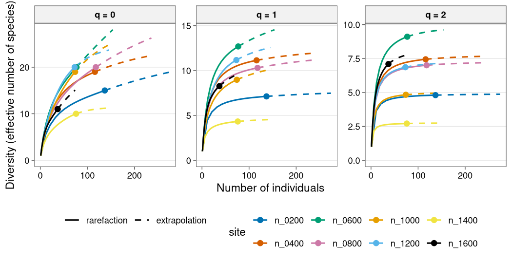

### Rarefaction and extrapolation by sample coverage

The same curves plotted against estimated sample coverage, the basis for
coverage-standardised comparison.

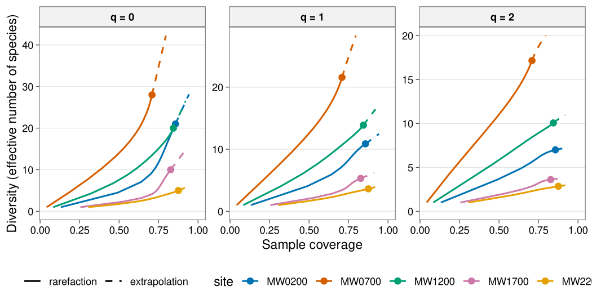

### Hill diversity profile

Observed Hill numbers across orders q from 0 (richness) to 3 (dominant
species), one line per site.

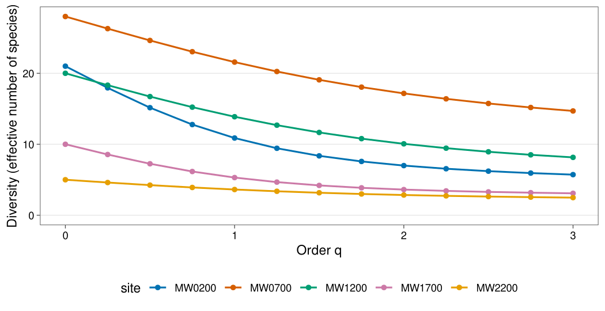

### Alpha diversity along elevation

Observed q = 0, 1 and 2 diversity at each elevation, one line per
season.

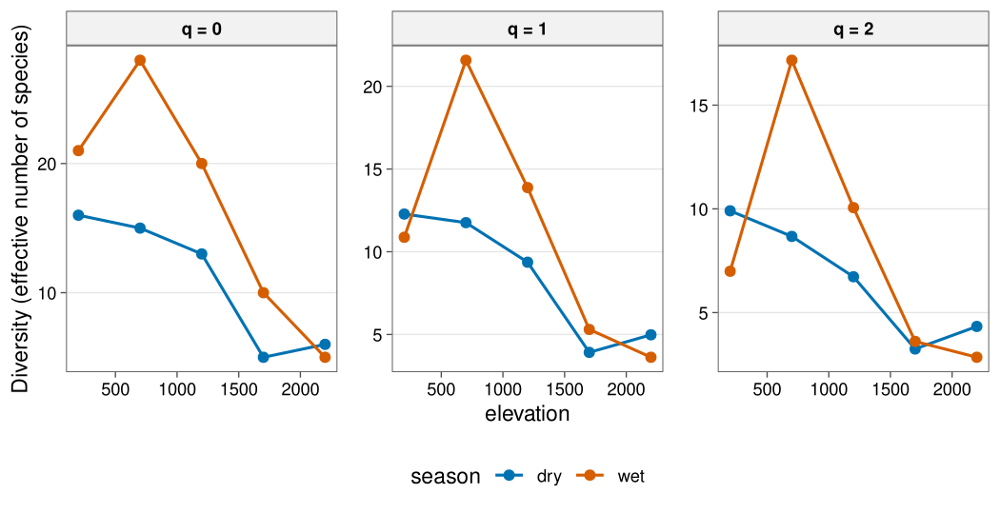

### Observed and asymptotic diversity

Open circles are observed values, filled circles the asymptotic
estimates, with 95% bootstrap intervals.

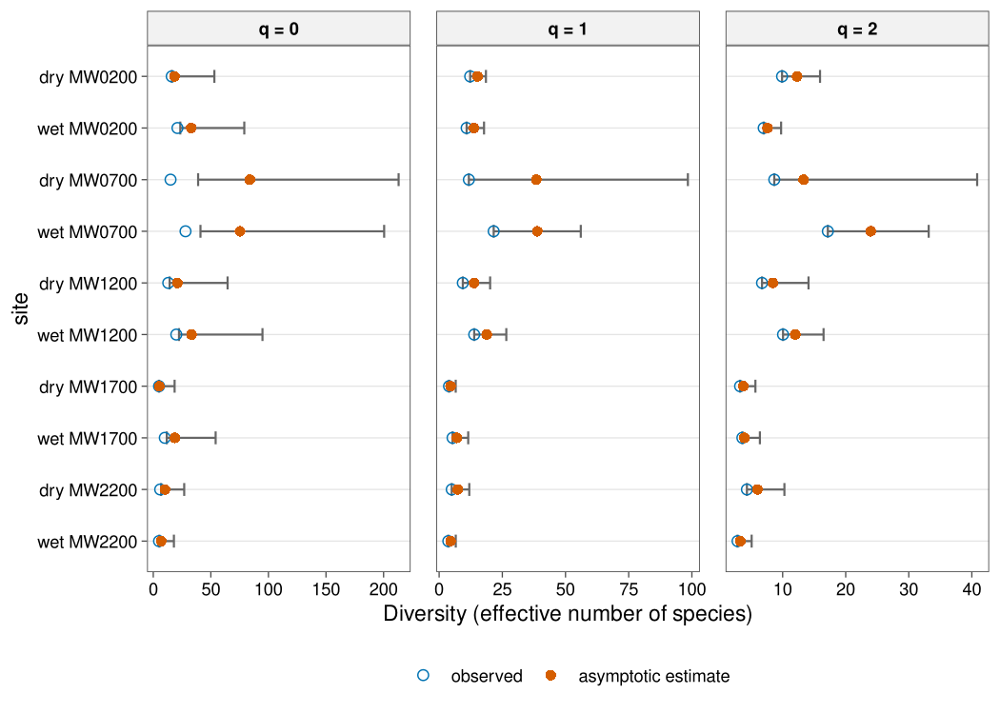

### Sample coverage

Estimated sample coverage of each site against its number of bait
occurrences.

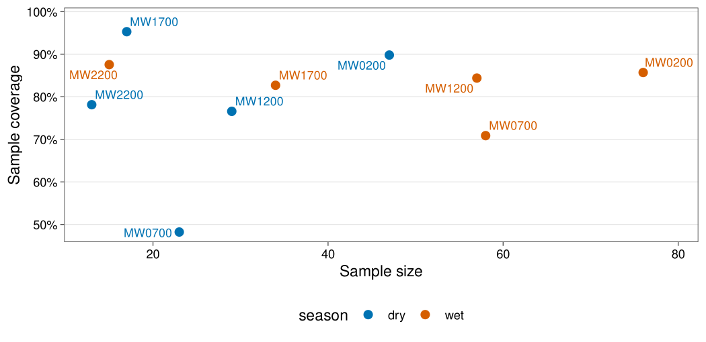

### Pairwise beta diversity heatmap

Total Sorensen dissimilarity between every pair of sites within each
season.

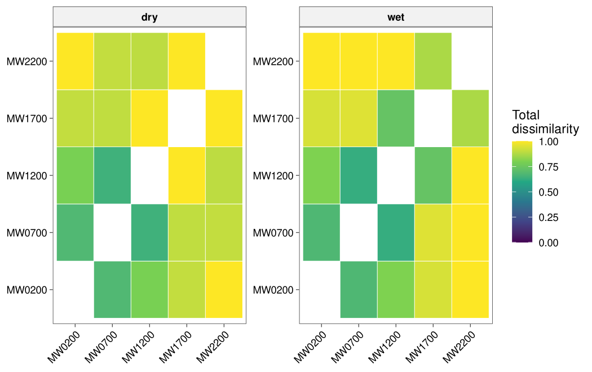

### Multi-site beta partition

Multi-site Sorensen dissimilarity of each season split into turnover and
nestedness.

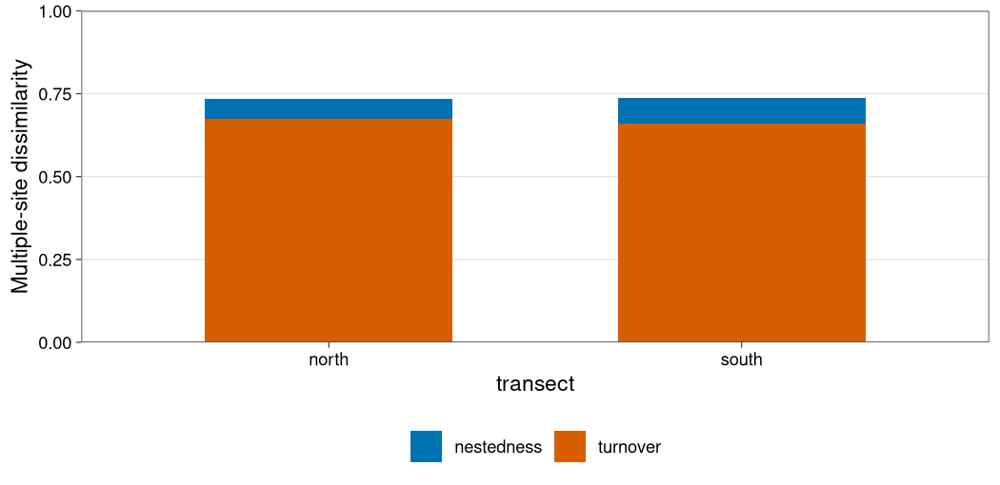

### Coverage-standardised beta diversity

Gamma, alpha and beta diversity of each season at 90% sample coverage,
with 95% bootstrap intervals.

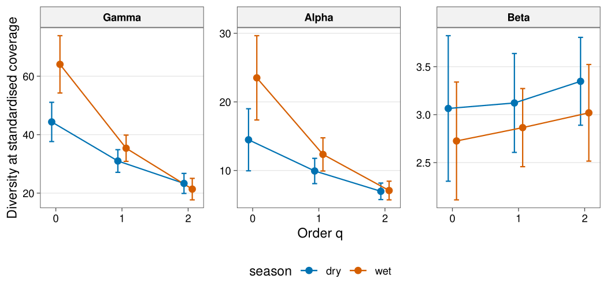

### Distance decay

Pairwise total, turnover and nestedness dissimilarity against elevation
difference, with quasibinomial (logit) trends that stay within 0-1.

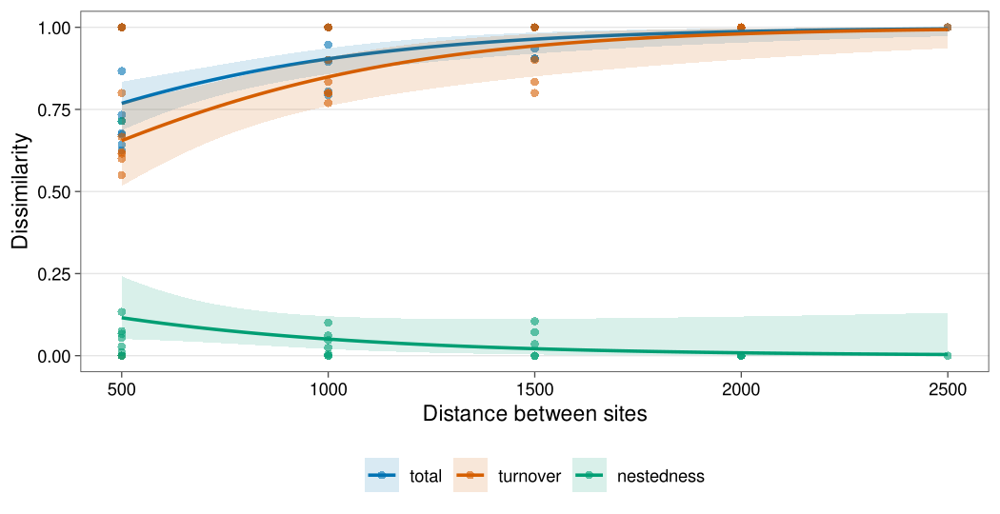


### Study-site map

Publication-ready study sites with a coast basemap, labels, scale bar and north arrow.

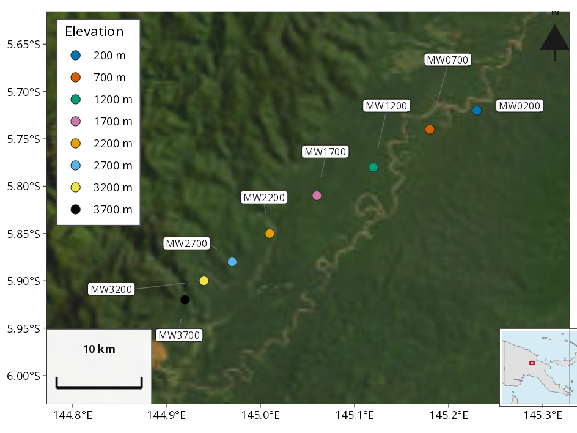

### Hill numbers on a map

Site-level Hill diversity estimates mapped with a colour-blind viridis scale.

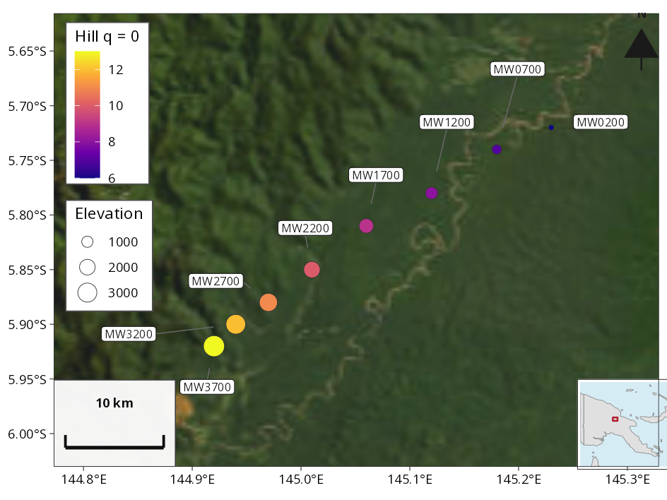

### Stems over topography

ForestGEO-style stem map with hillshade and contours (illustrative local-metre plot).

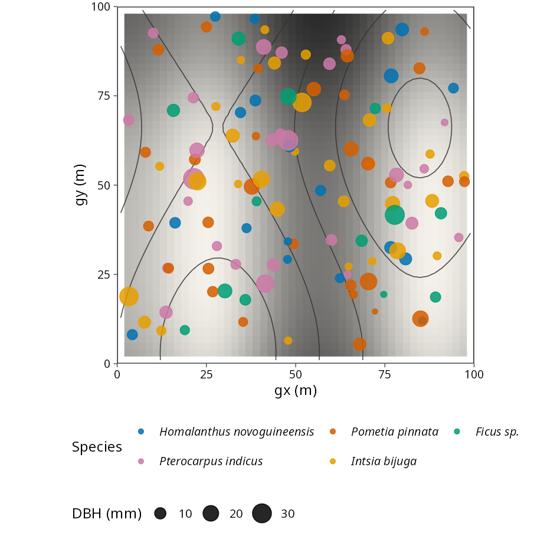

### Basemap and bioclim

OSM/Carto/ESRI tiles (with offline coast fallback) and WorldClim/CHELSA bioclim extracts feed the same tidy workflow.

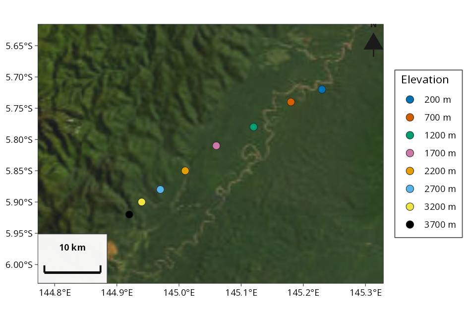

### Species distribution model (demonstration)

Tidy presence-absence / presence-background SDM prediction map. Simulated data: a species present only at high bio1.

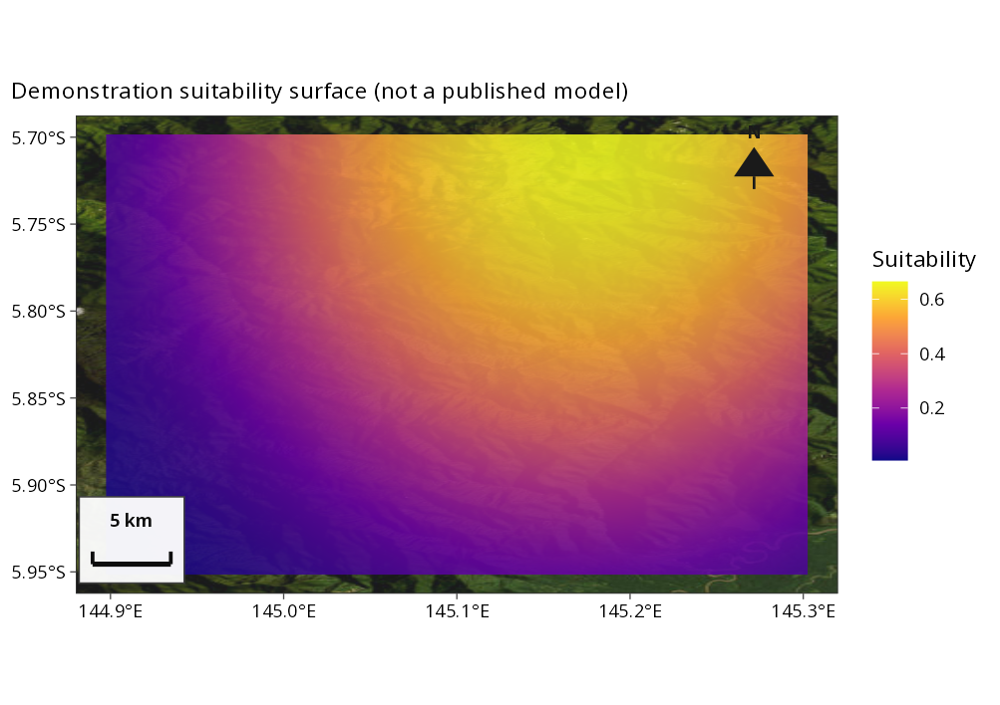

## Output tables

Example output of every main function on `png_ants`. Long tables show
their first rows.

### `div_hill()`

Observed Hill numbers: `n` occurrences, `diversity` of order `q` per
site.

| season | site   |   q |   n | diversity |
|:-------|:-------|----:|----:|----------:|
| dry    | MW0200 |   0 |  47 |    16.000 |
| dry    | MW0200 |   1 |  47 |    12.278 |
| dry    | MW0200 |   2 |  47 |     9.906 |
| wet    | MW0200 |   0 |  76 |    21.000 |
| wet    | MW0200 |   1 |  76 |    10.876 |
| wet    | MW0200 |   2 |  76 |     6.993 |
| dry    | MW0700 |   0 |  23 |    15.000 |
| dry    | MW0700 |   1 |  23 |    11.758 |

### `div_estimate()`

Asymptotic estimates: `observed` and `estimate` Hill numbers with
bootstrap `se`, `lower` and `upper` 95% limits.

| season | site   |   q | observed | estimate |     se |  lower |   upper |
|:-------|:-------|----:|---------:|---------:|-------:|-------:|--------:|
| dry    | MW0200 |   0 |   16.000 |   18.447 |  5.913 | 16.162 |  53.059 |
| dry    | MW0200 |   1 |   12.278 |   15.183 |  1.700 | 12.278 |  18.515 |
| dry    | MW0200 |   2 |    9.906 |   12.284 |  1.859 |  9.906 |  15.928 |
| wet    | MW0200 |   0 |   21.000 |   32.941 | 11.434 | 23.457 |  79.036 |
| wet    | MW0200 |   1 |   10.876 |   13.793 |  2.024 | 10.876 |  17.761 |
| wet    | MW0200 |   2 |    6.993 |    7.600 |  1.099 |  6.993 |   9.754 |
| dry    | MW0700 |   0 |   15.000 |   83.870 | 39.982 | 38.949 | 213.049 |
| dry    | MW0700 |   1 |   11.758 |   38.453 | 30.595 | 11.758 |  98.417 |

### `div_coverage()`

Sample coverage: `n` occurrences, `s_obs` observed species, `f1`
singletons, `f2` doubletons and estimated `coverage`.

| season | site   |   n | s_obs |  f1 |  f2 | coverage |
|:-------|:-------|----:|------:|----:|----:|---------:|
| dry    | MW0200 |  47 |    16 |   5 |   5 |    0.898 |
| wet    | MW0200 |  76 |    21 |  11 |   5 |    0.857 |
| dry    | MW0700 |  23 |    15 |  12 |   1 |    0.482 |
| wet    | MW0700 |  58 |    28 |  17 |   3 |    0.709 |
| dry    | MW1200 |  29 |    13 |   7 |   3 |    0.766 |
| wet    | MW1200 |  57 |    20 |   9 |   3 |    0.844 |
| dry    | MW1700 |  17 |     5 |   1 |   2 |    0.953 |
| wet    | MW1700 |  34 |    10 |   6 |   2 |    0.827 |

### `div_rarefy()`

Rarefaction and extrapolation: diversity of order `q` at sample size
`m`, whether `method` is rarefaction, observed or extrapolation, the
expected `coverage`, and `lower` and `upper` limits (`NA` when
`nboot = 0`).

| site   |   q |   m | method        | diversity | coverage | lower | upper |
|:-------|----:|----:|:--------------|----------:|---------:|------:|------:|
| MW0200 |   0 |   1 | rarefaction   |     1.000 |    0.132 |    NA |    NA |
| MW0200 |   0 |  38 | rarefaction   |    14.140 |    0.780 |    NA |    NA |
| MW0200 |   0 |  75 | rarefaction   |    20.855 |    0.855 |    NA |    NA |
| MW0200 |   0 |  76 | observed      |    21.000 |    0.857 |    NA |    NA |
| MW0200 |   0 |  77 | extrapolation |    21.143 |    0.859 |    NA |    NA |
| MW0200 |   0 | 102 | extrapolation |    24.211 |    0.895 |    NA |    NA |
| MW0200 |   0 | 127 | extrapolation |    26.482 |    0.923 |    NA |    NA |
| MW0200 |   0 | 152 | extrapolation |    28.162 |    0.943 |    NA |    NA |

### `div_standardise()`

Coverage standardisation: `diversity` of order `q` at a common
`coverage` for every site, with the matching sample size `m`, the
`method` used, and bootstrap `se`, `lower` and `upper` limits.

| season | site   |   q |      m | method        | coverage | diversity |    se |  lower |  upper |
|:-------|:-------|----:|-------:|:--------------|---------:|----------:|------:|-------:|-------:|
| dry    | MW0200 |   0 | 11.646 | rarefaction   |    0.565 |     7.963 | 0.458 |  7.067 |  8.860 |
| dry    | MW0200 |   1 | 11.646 | rarefaction   |    0.565 |     7.099 | 0.513 |  6.093 |  8.105 |
| dry    | MW0200 |   2 | 11.646 | rarefaction   |    0.565 |     6.236 | 0.534 |  5.189 |  7.283 |
| wet    | MW0200 |   0 | 45.094 | rarefaction   |    0.796 |    15.651 | 1.415 | 12.877 | 18.425 |
| wet    | MW0200 |   1 | 45.094 | rarefaction   |    0.796 |     9.570 | 1.071 |  7.471 | 11.668 |
| wet    | MW0200 |   2 | 45.094 | rarefaction   |    0.796 |     6.630 | 0.816 |  5.031 |  8.228 |
| dry    | MW0700 |   0 | 46.000 | extrapolation |    0.565 |    25.975 | 5.306 | 15.575 | 36.374 |
| dry    | MW0700 |   1 | 46.000 | extrapolation |    0.565 |    17.858 | 6.141 |  5.821 | 29.895 |

### `beta_pair()`

Pairwise beta diversity: Sorensen `turnover` (Simpson) and `nestedness`
components, which sum to `total` dissimilarity.

| season | site_1 | site_2 | turnover | nestedness | total |
|:-------|:-------|:-------|---------:|-----------:|------:|
| dry    | MW0200 | MW0700 |    0.667 |      0.011 | 0.677 |
| dry    | MW0200 | MW1200 |    0.769 |      0.024 | 0.793 |
| dry    | MW0200 | MW1700 |    0.800 |      0.105 | 0.905 |
| dry    | MW0200 | MW2200 |    1.000 |      0.000 | 1.000 |
| dry    | MW0700 | MW1200 |    0.615 |      0.027 | 0.643 |
| dry    | MW0700 | MW1700 |    0.800 |      0.100 | 0.900 |
| dry    | MW0700 | MW2200 |    0.833 |      0.071 | 0.905 |
| dry    | MW1200 | MW1700 |    1.000 |      0.000 | 1.000 |

### `beta_multi()`

Multi-site beta diversity: `n_sites` in each group with the multi-site
`turnover`, `nestedness` and `total`.

| season | n_sites | turnover | nestedness | total |
|:-------|--------:|---------:|-----------:|------:|
| dry    |       5 |    0.827 |      0.051 | 0.877 |
| wet    |       5 |    0.790 |      0.074 | 0.864 |

### `beta_decay()`

Distance decay: the pairwise components plus each site’s `gradient_1`
and `gradient_2` values and their `distance`.

| season | site_1 | site_2 | turnover | nestedness | total | gradient_1 | gradient_2 | distance |
|:-------|:-------|:-------|---------:|-----------:|------:|-----------:|-----------:|---------:|
| dry    | MW0200 | MW0700 |    0.667 |      0.011 | 0.677 |        200 |        700 |      500 |
| dry    | MW0200 | MW1200 |    0.769 |      0.024 | 0.793 |        200 |       1200 |     1000 |
| dry    | MW0200 | MW1700 |    0.800 |      0.105 | 0.905 |        200 |       1700 |     1500 |
| dry    | MW0200 | MW2200 |    1.000 |      0.000 | 1.000 |        200 |       2200 |     2000 |
| dry    | MW0700 | MW1200 |    0.615 |      0.027 | 0.643 |        700 |       1200 |      500 |
| dry    | MW0700 | MW1700 |    0.800 |      0.100 | 0.900 |        700 |       1700 |     1000 |
| dry    | MW0700 | MW2200 |    0.833 |      0.071 | 0.905 |        700 |       2200 |     1500 |
| dry    | MW1200 | MW1700 |    1.000 |      0.000 | 1.000 |       1200 |       1700 |      500 |

### `beta_decay_model()`

Distance-decay model of similarity: the fitted `a` and rate `b`, the
`half_distance` over which similarity halves, the `pseudo_r2`, `aic` and
a site-permutation `p.value`.

| season | model       | component | n_pairs |     a |     b | half_distance | pseudo_r2 |     aic | p.value |
|:-------|:------------|:----------|--------:|------:|------:|--------------:|----------:|--------:|--------:|
| dry    | exponential | total     |      10 | 0.257 | 0.001 |       924.159 |     0.143 |  -9.214 |   0.349 |
| wet    | exponential | total     |      10 | 0.897 | 0.002 |       293.331 |     0.694 | -17.577 |   0.017 |

### `beta_hill_pair()`

Pairwise Hill-number beta diversity of order `q` with the four
normalised dissimilarities (first rows shown).

| season | site_1 | site_2 |   q | gamma | alpha |  beta | dis_sorensen | dis_jaccard | dis_turnover_sorensen | dis_turnover_jaccard |
|:-------|:-------|:-------|----:|------:|------:|------:|-------------:|------------:|----------------------:|---------------------:|
| dry    | MW0200 | MW0700 |   0 |    26 |  15.5 | 1.677 |        0.677 |       0.808 |                 0.677 |                0.808 |
| dry    | MW0200 | MW1200 |   0 |    26 |  14.5 | 1.793 |        0.793 |       0.885 |                 0.793 |                0.885 |
| dry    | MW0200 | MW1700 |   0 |    20 |  10.5 | 1.905 |        0.905 |       0.950 |                 0.905 |                0.950 |
| dry    | MW0200 | MW2200 |   0 |    22 |  11.0 | 2.000 |        1.000 |       1.000 |                 1.000 |                1.000 |
| dry    | MW0700 | MW1200 |   0 |    23 |  14.0 | 1.643 |        0.643 |       0.783 |                 0.643 |                0.783 |
| dry    | MW0700 | MW1700 |   0 |    19 |  10.0 | 1.900 |        0.900 |       0.947 |                 0.900 |                0.947 |

### `beta_hill()`

Coverage-standardised beta diversity: `gamma`, `alpha` and `beta` of
order `q` at a common `coverage`, the sample sizes used (`m_gamma`,
`m_alpha`) and four normalised dissimilarities.

| season |   q | coverage | m_gamma | m_alpha |  gamma |  alpha |  beta | n_sites | dis_sorensen | dis_jaccard | dis_turnover_sorensen | dis_turnover_jaccard |
|:-------|----:|---------:|--------:|--------:|-------:|-------:|------:|--------:|-------------:|------------:|----------------------:|---------------------:|
| dry    |   0 |      0.9 | 150.161 | 244.117 | 44.361 | 14.476 | 3.064 |       5 |        0.516 |       0.842 |                 0.516 |                0.842 |
| dry    |   1 |      0.9 | 150.161 | 244.117 | 30.995 |  9.929 | 3.122 |       5 |        0.707 |       0.707 |                 0.530 |                0.850 |
| dry    |   2 |      0.9 | 150.161 | 244.117 | 23.324 |  6.968 | 3.347 |       5 |        0.877 |       0.587 |                 0.587 |                0.877 |
| wet    |   0 |      0.9 | 259.764 | 480.767 | 64.058 | 23.502 | 2.726 |       5 |        0.431 |       0.791 |                 0.431 |                0.791 |
| wet    |   1 |      0.9 | 259.764 | 480.767 | 35.366 | 12.345 | 2.865 |       5 |        0.654 |       0.654 |                 0.466 |                0.814 |
| wet    |   2 |      0.9 | 259.764 | 480.767 | 21.377 |  7.081 | 3.019 |       5 |        0.836 |       0.505 |                 0.505 |                0.836 |

### `beta_welch()`

Welch-type PERMANOVA (W\*d), robust to unequal dispersion: the
`statistic`, the numbers of groups and sites, and the permutation
`p.value`.

| statistic | n_groups | n_sites | p.value |
|----------:|---------:|--------:|--------:|
|      1.29 |        2 |      20 |   0.179 |

## References

- Chao, A. et al. (2014). Rarefaction and extrapolation with Hill
  numbers. *Ecological Monographs*, 84, 45-67.
- Chao, A. and Jost, L. (2012). Coverage-based rarefaction and
  extrapolation. *Ecology*, 93, 2533-2547.
- Baselga, A. (2010). Partitioning the turnover and nestedness
  components of beta diversity. *Global Ecology and Biogeography*, 19,
  134-143.
- Blanchet, F. G., Legendre, P. and Borcard, D. (2008). Forward
  selection of explanatory variables. *Ecology*, 89, 2623-2632.
- Carmona, C. P. et al. (2019). Trait probability density (TPD):
  measuring functional diversity across scales based on TPD with R.
  *Ecology*, 100, e02876.
- Chao, A., Chiu, C.-H. and Jost, L. (2014). Unifying species diversity,
  phylogenetic diversity, functional diversity, and related similarity
  and differentiation measures through Hill numbers. *Annual Review of
  Ecology, Evolution, and Systematics*, 45, 297-324.
- Chao, A. et al. (2019). An attribute-diversity approach to functional
  diversity, functional beta diversity, and related (dis)similarity
  measures. *Ecological Monographs*, 89, e01343.
- Chao, A. et al. (2023). Rarefaction and extrapolation with beta
  diversity under a framework of Hill numbers: the iNEXT.beta3D
  standardization. *Ecological Monographs*, 93, e1588.
- de Bello, F. et al. (2021). *Handbook of Trait-Based Ecology: From
  Theory to R Tools*. Cambridge University Press.
- Hamidi, B. et al. (2019). W*d-test: robust distance-based multivariate
  analysis of variance. *Microbiome\*, 7, 51.
- Gómez-Rodríguez, C. and Baselga, A. (2018). Variation among European
  beetle taxa in patterns of distance decay of similarity suggests a
  major role of dispersal processes. *Ecography*, 41, 1825-1834.
- Moses, J. et al. (2023). Nutrient use by tropical ant communities
  varies among three extensive elevational gradients: a
  cross-continental comparison. *Global Ecology and Biogeography*, 32,
  2212-2229.
- Nekola, J. C. and White, P. S. (1999). The distance decay of
  similarity in biogeography and ecology. *Journal of Biogeography*, 26,
  867-878.
- Zeleny, D. (2018). Which results of the standard test for
  community-weighted mean approach are too optimistic? *Journal of
  Vegetation Science*, 29, 953-966.

## Licence

MIT © Jimmy Moses
