# A gallery of ordination diagrams

Every diagram in this gallery is drawn with one function,
[`autoplot()`](https://ggplot2.tidyverse.org/reference/autoplot.html),
by choosing its `type`. All share the same look
([`ord_style()`](https://tidydiversity.in4metrix.dev/reference/ord_style.md)),
which can be changed freely. The examples use the classic data sets of
community ecology that ship with **vegan**, so each result can be
compared with the textbooks and with CANOCO’s manual (ter Braak and
Šmilauer 2012; Legendre and Legendre 2012):

| Data | Community | Site variables | Used for |
|----|----|----|----|
| `dune`, `dune.env` | 30 plant species in 20 meadows (Jongman et al. 1995) | A1 horizon thickness, moisture, management, use, manure | biplots, t-value biplots, Van Dobben circles, stability |
| `varespec`, `varechem` | 44 lichen and plant species in 24 pine-heath plots (Väre et al. 1995) | 14 soil variables | contours, gradients, species response curves, variation partitioning |
| `mite`, `mite.env` | 35 oribatid mite taxa in 70 peat cores (Borcard and Legendre 1994) | substrate density, water content, cover | NMDS and its Shepard diagram |
| `pyrifos` | 178 macro-invertebrate taxa in 12 ditches over 11 weeks (van den Brink and ter Braak 1999) | insecticide dose, week | principal response curves |

``` r

library(tidydiversity)
library(ggplot2)
library(vegan)
#> Loading required package: permute
data(dune, dune.env, varespec, varechem, mite, mite.env, pyrifos)

# Long (tidy) tables: one row per site and species
long <- function(comm, env) {
  community_long(cbind(site = rownames(comm), env, comm), cols = dplyr::all_of(names(comm)))
}
dune_l <- long(dune, dune.env)
vare_l <- long(varespec, varechem)
mite_l <- long(mite, mite.env)
```

## Which ordination? Ask the tidyvisor

Whether to use an unconstrained ordination (to describe) or a
constrained one (to test site variables), a linear or a unimodal method,
and which test goes with it, depends on the question and on the data.
[`ord_advise()`](https://tidydiversity.in4metrix.dev/reference/ord_advise.md)
measures the data (zeros, presence-absence, rare species, the length of
the main gradient, the number and collinearity of the site variables)
and returns its advice with the reasons and the code to run:

``` r

tidyvisor(dune_l, abundance = abundance, formula = ~ A1 + Moisture + Management)
#> 
#> ── tidyvisor: which analysis? ──────────────────────────────────────────────────
#> Question: explain
#> 
#> ── What the data show ──
#> 
#> • Sites: "20"
#> • Species: "30"
#> • Data: "abundances"
#> • Zeros: "67%" — many zeros: shared absences must not make sites similar
#>   (Hellinger or Bray-Curtis)
#> • Species in one site only: "10%"
#> • Gradient length (DCA axis 1, SD units): "3.52" — intermediate: linear or
#>   unimodal methods both suit
#> • Site variables (model terms): "7" — many terms for the sites: select
#>   variables (forward selection)
#> 
#> ── Recommended ──
#> 
#> Approach: Constrained (direct, canonical) ordination
#> You have a hypothesis that measured site variables explain composition.
#> Method: RDA on Hellinger-transformed data (or db-RDA)
#> Gradient length 3.5 SD.
#> ord <- ord_fit(data, abundance = abundance, method = "rda", transform = "hellinger", formula = ~A1 + Moisture + Management)
#> Select: Forward selection of variables
#> Too many or collinear variables inflate the explained variation and make the
#> test unreliable.
#> ord_select(data, abundance = abundance, formula = ~A1 + Moisture + Management)
#> Test: Permutation tests: the whole model, each axis and each term
#> The F-test of a constrained ordination has no parametric distribution;
#> permuting sites gives p-values.
#> ord_test(ord, by = "model"); ord_test(ord, by = "axis"); ord_test(ord, by = "margin")
#> Plots: Triplot; species response curves along the main variable; t-value biplot
#> or Van Dobben circles
#> The triplot shows sites, species and variables together; response curves show
#> each species' optimum and tolerance with confidence bands; Van Dobben circles
#> single out the species that respond significantly.
#> autoplot(ord)
#> autoplot(ord, type = "response", variable = "<numeric>")
#> autoplot(ord, type = "vandobben", variable = "<numeric>")
#> Interpret: Plain-language explanation of the tables and the diagram
#> Variation explained, tests, directions of variables, groups, species at each
#> end of the axes, and how to read the plot.
#> ord_interpret(ord)
```

Without a formula it advises an unconstrained ordination; with factors
only, PERMANOVA; with a treatment and a time, principal response curves.

| Question | Approach | Linear (gradient \< 3 SD) | Unimodal (\> 4 SD) | Any data (distances) | Test |
|----|----|----|----|----|----|
| What are the main patterns? | unconstrained | PCA (Hellinger) | CA | NMDS, PCoA | none; fitted variables are descriptive |
| Do measured variables explain composition? | constrained | RDA (Hellinger) | CCA | db-RDA | permutation: model, axes, terms; forward selection |
| Do groups of sites differ? | constrained | RDA | CCA | PERMANOVA, db-RDA | PERMANOVA and dispersion |
| How do treatments depart from a control over time? | partial constrained | PRC |  |  | permutation within times |
| How much do sets of variables explain, alone and together? | partial constrained | variation partitioning |  |  | adjusted R²; unique fractions tested |

Once fitted, the same
[`tidyvisor()`](https://tidydiversity.in4metrix.dev/reference/tidyvisor.md)
(calling
[`ord_interpret()`](https://tidydiversity.in4metrix.dev/reference/ord_interpret.md))
explains the results in sentences that can be checked against the tables
and the diagram: how much the axes hold, what the tests say, which way
each variable runs, where the groups lie, which species define each end
of the axes, and how to read the plot.

``` r

rda_dune <- ord_fit(dune_l,
  abundance = abundance, method = "rda", transform = "hellinger",
  formula = ~ A1 + Moisture + Management
)
tidyvisor(rda_dune, permutations = 199)
#> 
#> ── tidyvisor: what the results show ────────────────────────────────────────────
#> 
#> ── Overview ──
#> 
#> • A redundancy analysis (RDA) of 20 sites and 30 species
#>   (Hellinger-transformed), constrained by A1, Moisture, Management.
#> 
#> ── Variation ──
#> 
#> • The site variables explain 58.1% of the variation in composition (adjusted R²
#>   = 33.7%, allowing for the number of variables).
#> • The first two constrained axes hold 26.9% and 16.1% of the total variation
#>   (73.9% of the explained part).
#> 
#> ── Tests ──
#> 
#> • Overall, composition is significantly related to the site variables
#>   (permutation F = 2.38, p = 0.005, 199 permutations).
#> • A1 has no significant unique effect (F = 1.28, p = 0.23), after allowing for
#>   the other variables.
#> • Moisture has a significant unique effect (F = 1.87, p = 0.01), after allowing
#>   for the other variables.
#> • Management has a significant unique effect (F = 1.87, p = 0.02), after
#>   allowing for the other variables.
#> 
#> ── Site variables ──
#> 
#> • A1 increases towards the left of the diagram, mostly along the first axis
#>   (biplot scores -0.63, -0.10).
#> • Moisture L increases towards the left of the diagram, mostly along the first
#>   axis (biplot scores -0.96, 0.03).
#> • Moisture Q increases towards the lower left of the diagram, mostly along the
#>   second axis (biplot scores -0.16, -0.32).
#> • Moisture C increases towards the lower left of the diagram, mostly along the
#>   second axis (biplot scores -0.17, -0.23).
#> • Moisture: 1 lies towards the right; 2 lies towards the right; 4 lies towards
#>   the top; 5 lies towards the left. The further apart two centroids, the more
#>   the composition of their sites differs.
#> • Management: BF lies towards the right; HF lies towards the upper right; NM
#>   lies towards the lower left; SF lies towards the top. The further apart two
#>   centroids, the more the composition of their sites differs.
#> 
#> ── Species ──
#> 
#> • Axis 1 (RDA1) runs from Agrostol, Eleopalu, Ranuflam (negative end) to
#>   Lolipere, Poaprat, Planlanc (positive end).
#> • Axis 2 (RDA2) runs from Salirepe, Scorautu, Anthodor (negative end) to
#>   Poatriv, Alopgeni, Agrostol (positive end).
#> 
#> ── Reading the diagram ──
#> 
#> • Sites (circles) close together have similar species composition.
#> • With species scaling, the angles between species (and between species and
#>   variable arrows) approximate their correlations; distances between sites are
#>   only approximate.
#> • Project a site or species perpendicularly onto an arrow: the further along
#>   the arrow, the higher the variable (or the stronger the species' association
#>   with it).
#> • Triangles are the centroids of the factor levels: the average position of
#>   their sites.
```

## 1. Which geometry for which kind of variable

Before the gallery, the rule every diagram follows (Bertin 1983; ter
Braak and Šmilauer 2012):

- **Sites** and **species** are individual objects: points. Sites are
  open circles (filled by a factor when one is given); species are
  crosses.
- A **numeric** site variable (thickness of the A1 horizon, pH) is a
  direction: an arrow, or a set of contours when its change is not
  linear.
- A **factor** (management type) is a set of groups: the centroid of
  each level, and optionally ellipses, hulls or spiders around its
  sites.
- A continuous colour ramp is never put on points: a numeric variable on
  the sites is shown in classes, by symbol size, or as contours.

## 2. The biplot (triplot)

A redundancy analysis (RDA) of the dune meadows constrained by the A1
horizon, moisture and management. Management types are centroids, A1 an
arrow; the boxed labels give the fit of each variable (r² and
permutation p).

``` r

rda_dune <- ord_fit(dune_l,
  abundance = abundance, method = "rda", transform = "hellinger",
  formula = ~ A1 + Moisture + Management
)
autoplot(rda_dune, colour = Management, ellipse = "sd")
```

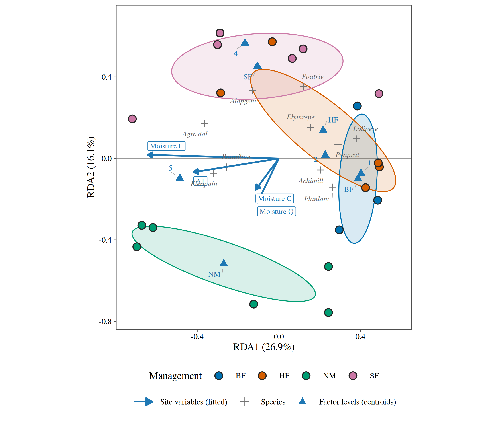

## 3. Contours of a numeric variable

When a variable does not change linearly across the diagram, an arrow
misleads; fitted contours (a generalised additive model of the variable
on the site scores, as in
[`vegan::ordisurf()`](https://vegandevs.github.io/vegan/reference/ordisurf.html))
show its real shape. Here the humus depth over an NMDS of the pine
heaths.

``` r

nmds_vare <- ord_fit(vare_l, abundance = abundance, method = "nmds", formula = ~ Humdepth + pH)
autoplot(nmds_vare, surface = Humdepth)
```

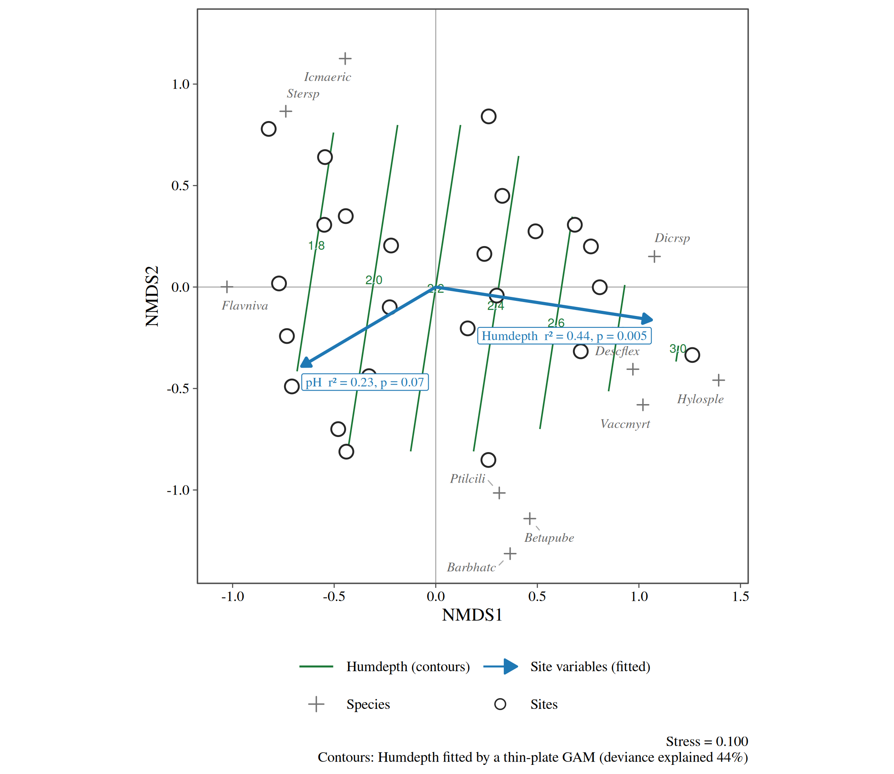

## 4. A numeric variable as symbol size

The same idea without contours: each site’s value as the size of its
symbol (a “bubble” plot), read from the legend in classes.

``` r

autoplot(nmds_vare, size = pH, species = 8)
```

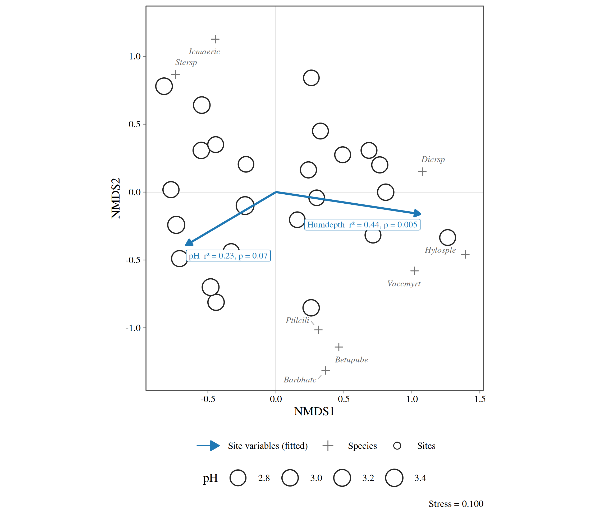

## 5. Gradient path

The sites joined in the order of a gradient: here the pine heaths
ordered by humus depth, showing how composition moves along it.

``` r

autoplot(nmds_vare, type = "gradient", path = Humdepth)
```

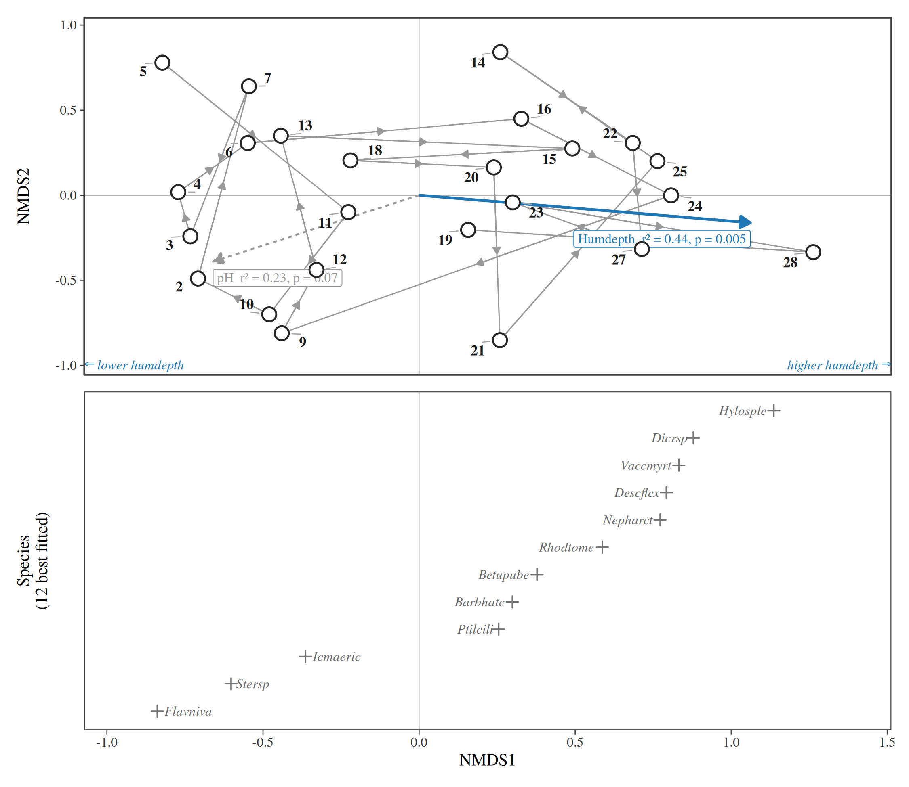

## 6. Species response curves

Abundance of the commonest species along the first axis (or a measured
variable), fitted by a Poisson generalised linear model with a quadratic
term; the bands are 95% confidence intervals computed on the link scale
and back-transformed.

``` r

autoplot(nmds_vare, type = "response", variable = "Humdepth", species = 6)
```

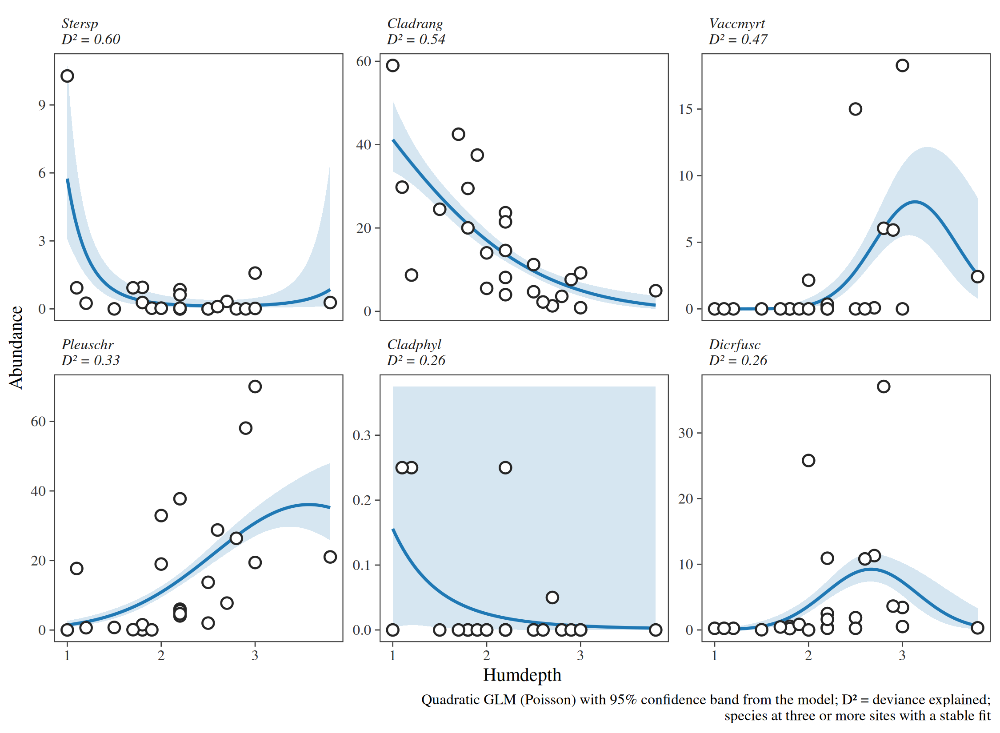

## 7. t-value biplot and Van Dobben circles

CANOCO’s diagram for asking which species respond significantly to one
variable. Each species is regressed on all the site variables; species
and coefficients are placed by a rank-2 approximation of the t-values.
The two dashed circles mark, approximately, the species with a
significant positive (red) or negative (blue) coefficient for A1; the
colours are the exact t-tests, so a species drawn red is significant
whether or not it falls inside the circle.

``` r

autoplot(rda_dune, type = "vandobben", variable = "A1")
```

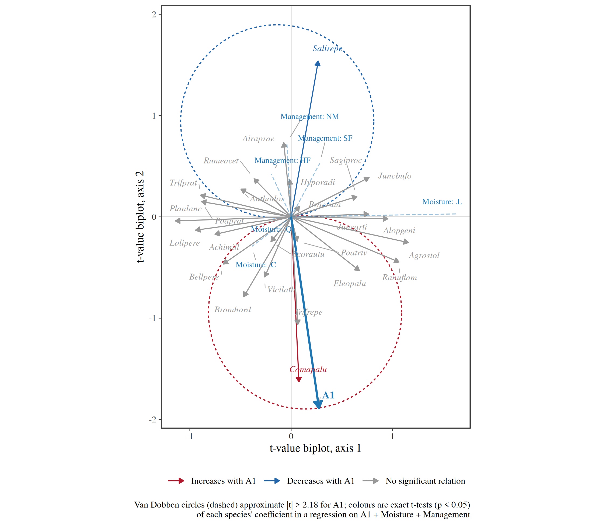

The simpler t-value plot, without circles, shows each species’ arrow in
the RDA biplot coloured by its exact test:

``` r

autoplot(rda_dune, type = "tvalue", variable = "A1")
```

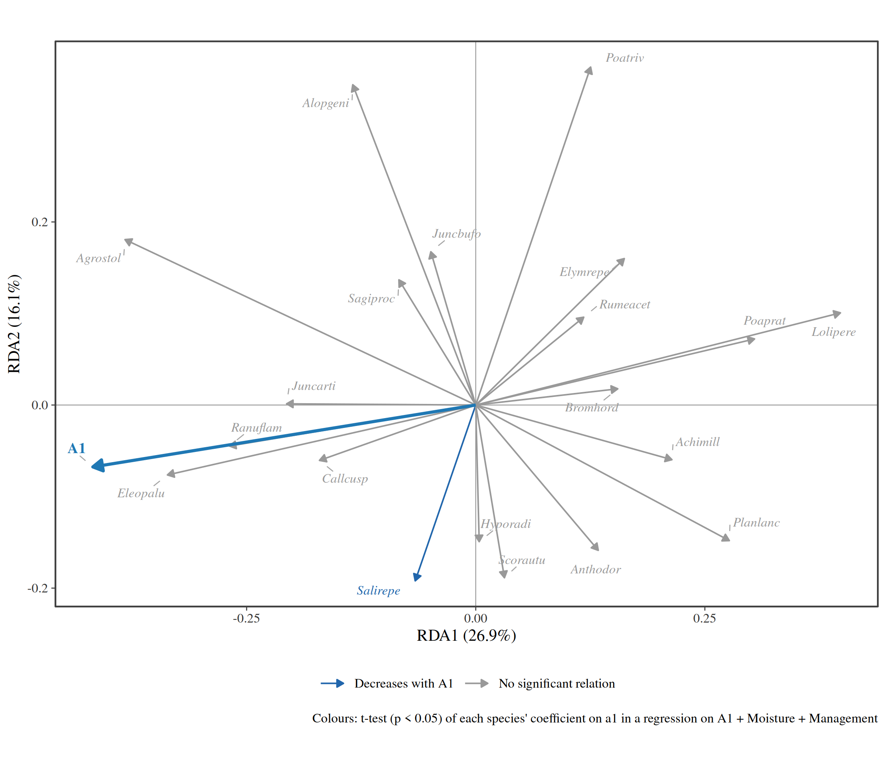

## 8. How stable is each site?

Resampling the species with replacement, refitting and rotating each fit
onto the original (Procrustes analysis) shows how firmly each site is
placed: sites with large ellipses could move a long way with a different
set of species.

``` r

pca_dune <- ord_fit(dune_l, abundance = abundance, method = "pca", transform = "hellinger")
set.seed(2024)
autoplot(pca_dune, type = "stability", nboot = 199)
```

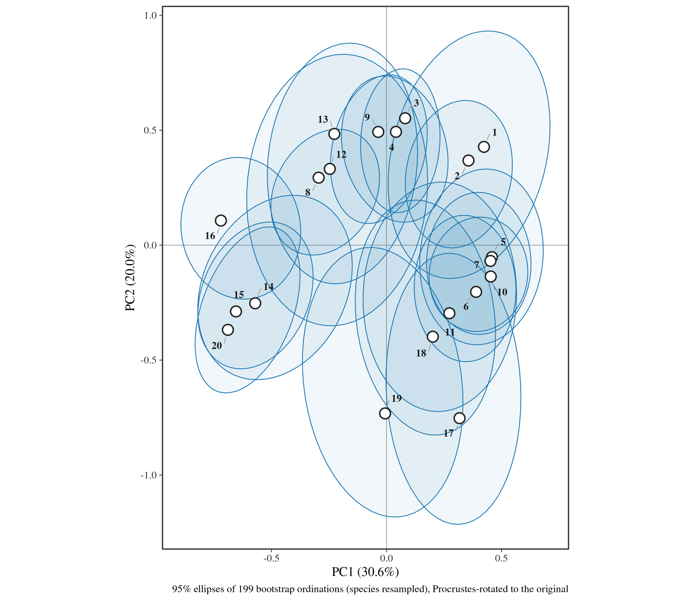

## 9. Diagnostics: scree and Shepard diagrams

How much variation each axis holds, against the broken-stick expectation
(axes above it are worth interpreting):

``` r

autoplot(pca_dune, type = "scree")
```

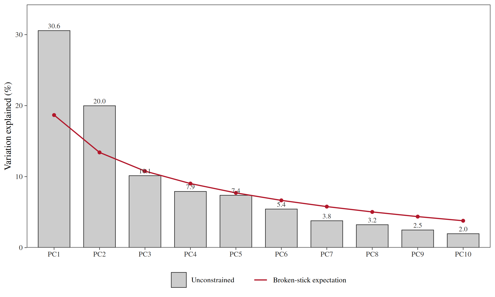

How well an NMDS keeps the observed dissimilarities, on the oribatid
mites:

``` r

nmds_mite <- ord_fit(mite_l, abundance = abundance, method = "nmds", formula = ~ WatrCont + Topo)
autoplot(nmds_mite, type = "shepard")
```

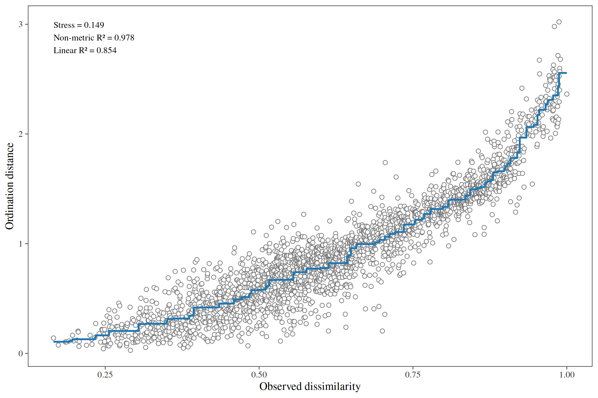

Either can be added as a small inset of the biplot itself:

``` r

autoplot(nmds_mite, colour = Topo, inset = "shepard", species = 8)
```

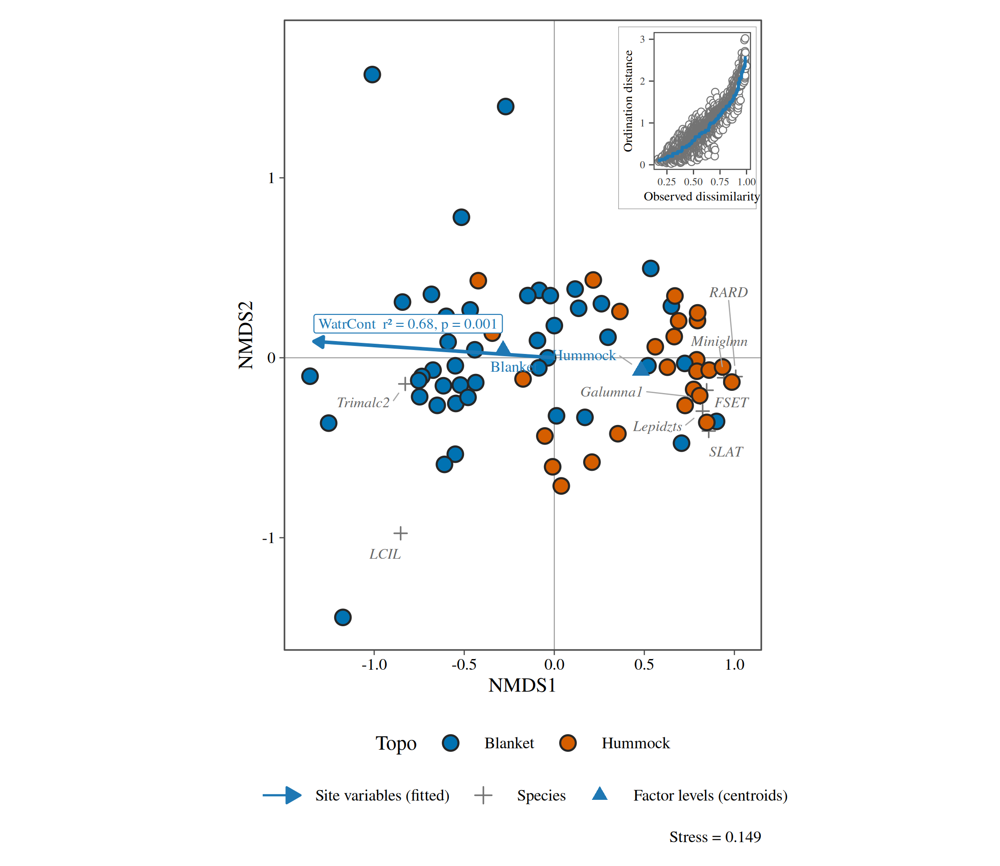

## 10. Variation partitioning

How much of the variation in the mite communities is explained by the
substrate, by the water content and by both together (adjusted R²;
Borcard et al. 1992).

``` r

vp <- ord_varpart(mite_l,
  abundance = abundance, transform = "hellinger",
  Substrate = ~ Substrate + SubsDens, Water = ~WatrCont, Shrubs = ~ Shrub + Topo
)
#> Warning in mx[i] <- deparse(out$call[[i + 2]], width.cutoff = 500): number of
#> items to replace is not a multiple of replacement length
#> Warning in mx[i] <- deparse(out$call[[i + 2]], width.cutoff = 500): number of
#> items to replace is not a multiple of replacement length
#> Warning in mx[i] <- deparse(out$call[[i + 2]], width.cutoff = 500): number of
#> items to replace is not a multiple of replacement length
autoplot(vp)
```

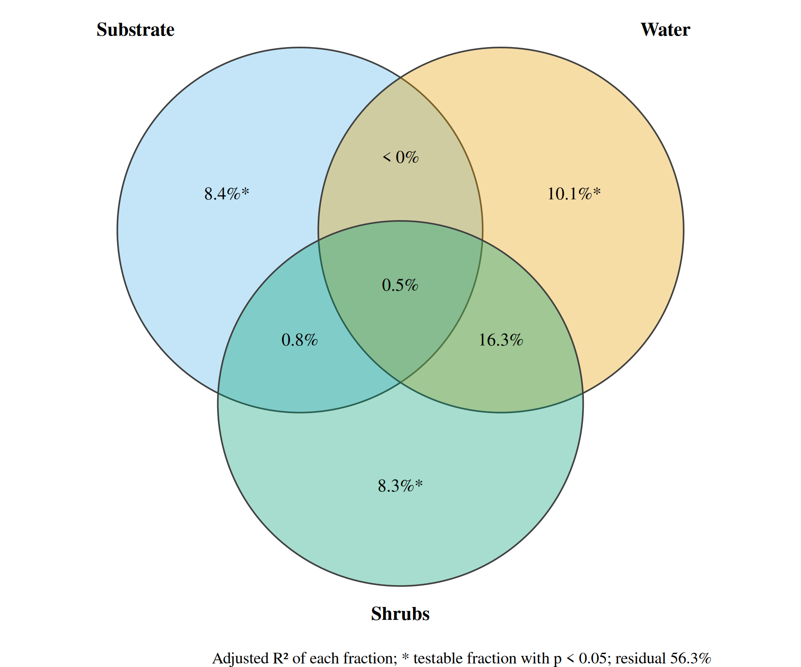

## 11. Principal response curves

The effect of the insecticide chlorpyrifos on the invertebrates of
experimental ditches, as each dose’s departure from the controls over
time (van den Brink and ter Braak 1999). Species with large weights
follow the curves; dosing was in week 0.

``` r

ditch <- gl(12, 1, length = 132)
week <- gl(11, 12, labels = c(-4, -1, 0.1, 1, 2, 4, 8, 12, 15, 19, 24))
dose <- factor(rep(c(0.1, 0, 0, 0.9, 0, 44, 6, 0.1, 44, 0.9, 0, 6), 11))
pyr <- data.frame(site = paste(ditch, week, sep = "_"), dose = dose, week = week, pyrifos)
pyr_l <- community_long(pyr, cols = dplyr::all_of(names(pyrifos)))
pr <- ord_prc(pyr_l,
  treatment = dose, time = week, abundance = abundance,
  transform = "none", permutations = 199
)
pr
#> Principal response curves: 4 treatments against "0", 11 times.
#> Treatment explains 42.8% of the variation after time; first axis F = 15.1, p =
#> 0.005.
autoplot(pr, weights = 1)
```

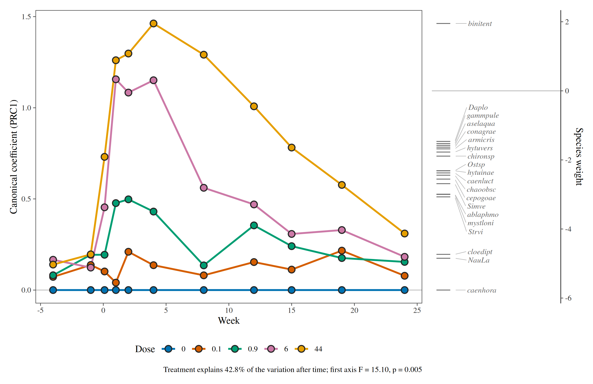

The `pyrifos` abundances are already log-transformed, hence
`transform = "none"`.

## 12. Changing the look

Every diagram takes `style = ord_style(...)`: fonts, symbol sizes and
colours, arrow and label colours, which statistics to print. The result
is an ordinary ggplot, so any further layer, scale or theme can be
added.

``` r

autoplot(rda_dune,
  colour = Management, hull = TRUE,
  style = ord_style(font = "sans", site_size = 4, env_colour = "#B2182B", label_size = 3.4)
) +
  labs(title = "Dune meadows")
```

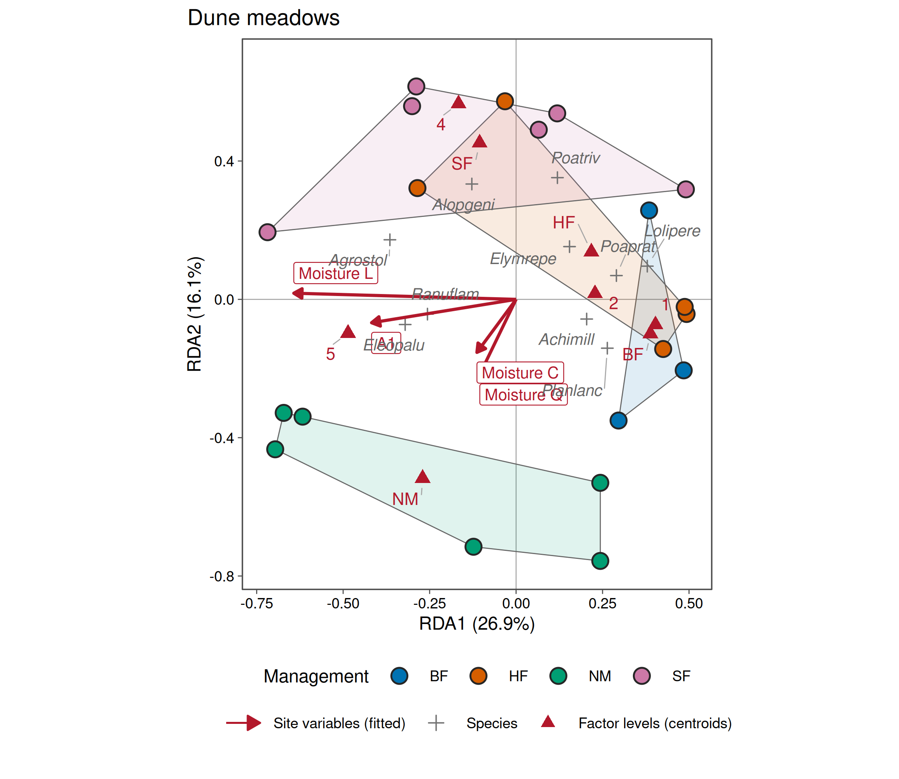

## References

Bertin, J. (1983). *Semiology of Graphics*. University of Wisconsin
Press.

Borcard, D. and Legendre, P. (1994). Environmental control and spatial
structure in ecological communities: an example using oribatid mites.
*Environmental and Ecological Statistics*, 1, 37-61.

Borcard, D., Legendre, P. and Drapeau, P. (1992). Partialling out the
spatial component of ecological variation. *Ecology*, 73, 1045-1055.

Jongman, R. H. G., ter Braak, C. J. F. and van Tongeren, O. F. R.
(1995). *Data Analysis in Community and Landscape Ecology*. Cambridge
University Press.

Legendre, P. and Legendre, L. (2012). *Numerical Ecology*, third
edition. Elsevier.

ter Braak, C. J. F. and Šmilauer, P. (2012). *Canoco Reference Manual
and User’s Guide: Software for Ordination (version 5.0)*. Microcomputer
Power.

van den Brink, P. J. and ter Braak, C. J. F. (1999). Principal response
curves: analysis of time-dependent multivariate responses of biological
community to stress. *Environmental Toxicology and Chemistry*, 18,
138-148.

Väre, H., Ohtonen, R. and Oksanen, J. (1995). Effects of reindeer
grazing on understorey vegetation in dry *Pinus sylvestris* forests.
*Journal of Vegetation Science*, 6, 523-530.
