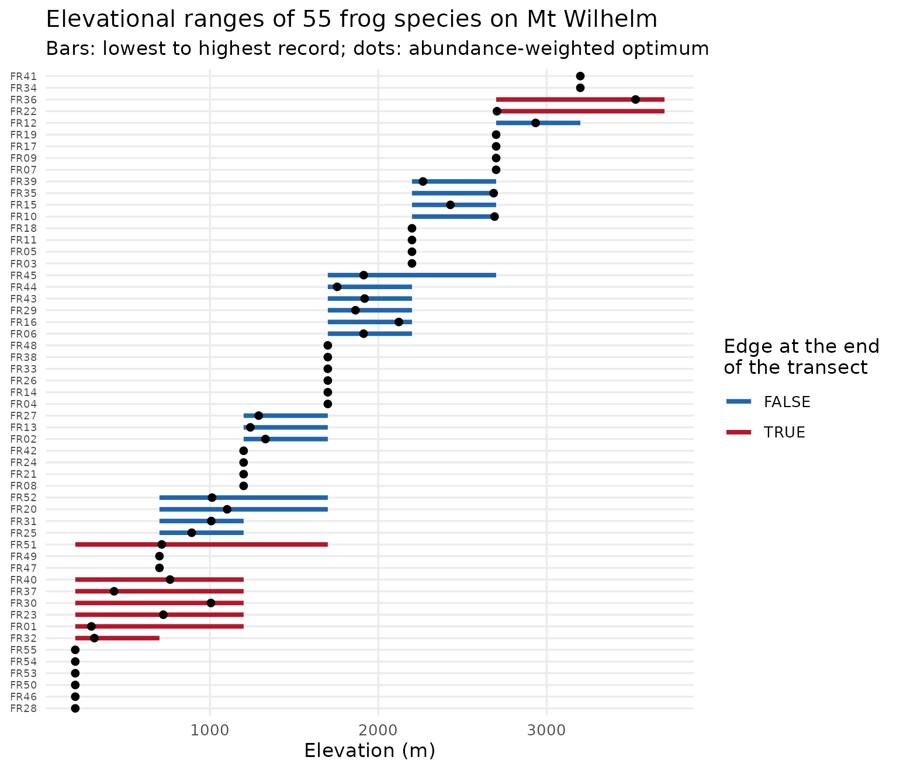
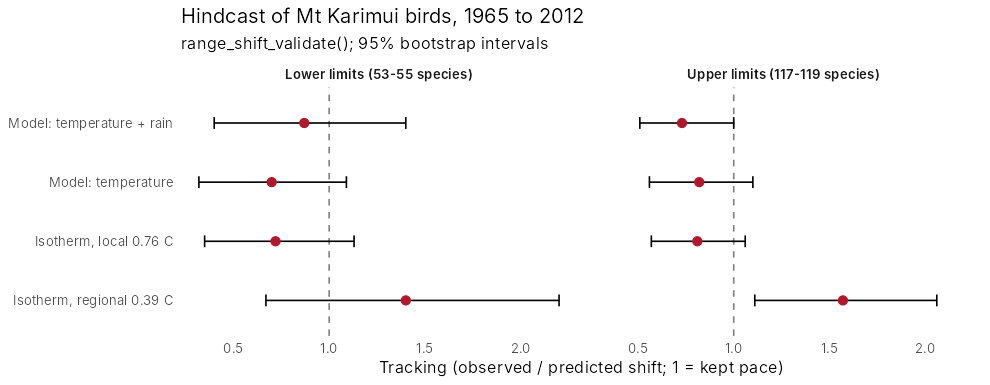

# Elevational ranges and range shifts

As the climate warms, species on mountains move upslope. tidydiversity
0.3.0 adds functions to describe where species sit on a gradient, to
measure how far they moved between a historical survey and a resurvey,
and to check whether a model predicted those moves.

| Function | What it does |
|----|----|
| [`range_edges()`](https://tidydiversity.in4metrix.dev/reference/range_edges.md) | Lower and upper edges, midpoint, breadth and abundance-weighted optimum of each species, with flags for edges cut off by the ends of the transect |
| [`range_shift_resurvey()`](https://tidydiversity.in4metrix.dev/reference/range_shift_resurvey.md) | Shifts of each edge, midpoint and optimum between two surveys; species lost and gained |
| [`range_shift_test()`](https://tidydiversity.in4metrix.dev/reference/range_shift_resurvey.md) | Mean shift across species, bootstrap interval and exact sign test |
| [`range_shift_expected()`](https://tidydiversity.in4metrix.dev/reference/range_shift_validate.md) | Shift that would keep a species at the same temperature: warming / lapse rate |
| [`range_shift_validate()`](https://tidydiversity.in4metrix.dev/reference/range_shift_validate.md) | Scores predicted against observed shifts: bias, error, correlation, calibration and tracking |

## Ranges of frogs on a New Guinea mountain

`png_frogs` holds frog counts at eight elevations from 200 to 3,700 m on
Mt Wilhelm (Dahl et al. 2024).

``` r

library(tidydiversity)
library(ggplot2)

edges <- range_edges(png_frogs, gradient = elevation, abundance = abundance)
edges
#> # A tibble: 55 × 10
#>    species lower upper midpoint breadth optimum n_sites abundance
#>    <chr>   <int> <int>    <dbl>   <int>   <dbl>   <int>     <int>
#>  1 FR01      200  1200      700    1000    296.       3       293
#>  2 FR02     1200  1700     1450     500   1330.       2        27
#>  3 FR03     2200  2200     2200       0   2200        1        32
#>  4 FR04     1700  1700     1700       0   1700        1       108
#>  5 FR05     2200  2200     2200       0   2200        1       137
#>  6 FR06     1700  2200     1950     500   1913.       2        47
#>  7 FR07     2700  2700     2700       0   2700        1        40
#>  8 FR08     1200  1200     1200       0   1200        1       133
#>  9 FR09     2700  2700     2700       0   2700        1        13
#> 10 FR10     2200  2700     2450     500   2690.       2       104
#> # ℹ 45 more rows
#> # ℹ 2 more variables: truncated_lower <lgl>, truncated_upper <lgl>
```

``` r

edges <- edges[order(edges$midpoint, edges$lower), ]
edges$species <- factor(edges$species, edges$species)
edges$cut_off <- edges$truncated_lower | edges$truncated_upper

ggplot(edges, aes(y = species)) +
  geom_segment(aes(x = lower, xend = upper, colour = cut_off), linewidth = 1.2) +
  geom_point(aes(x = optimum), size = 1.6) +
  scale_colour_manual(
    "Edge at the end\nof the transect",
    values = c(`FALSE` = "#2166AC", `TRUE` = "#B2182B")
  ) +
  labs(
    x = "Elevation (m)", y = NULL,
    title = "Elevational ranges of 55 frog species on Mt Wilhelm",
    subtitle = "Bars: lowest to highest record; dots: abundance-weighted optimum"
  ) +
  theme_minimal(base_size = 11) +
  theme(axis.text.y = element_text(size = 6), panel.grid.minor = element_blank())
```



Species whose edges lie at 200 m or 3,700 m may range beyond the
transect. Their edges cannot show a shift, so
[`range_shift_test()`](https://tidydiversity.in4metrix.dev/reference/range_shift_resurvey.md)
and
[`range_shift_validate()`](https://tidydiversity.in4metrix.dev/reference/range_shift_validate.md)
leave them out by default.

## How far should species move?

The shift that would keep a species at the same temperature is the
warming divided by the lapse rate. With the 0.76 degrees C of warming
measured on Mt Karimui between 1965 and 2012 and a lapse rate of 5.1
degrees C per km:

``` r

range_shift_expected(warming = 0.76, lapse_rate = 5.1)
#> [1] 149.0196
```

## Did the models predict the climb?

With a historical survey and a resurvey,
[`range_shift_resurvey()`](https://tidydiversity.in4metrix.dev/reference/range_shift_resurvey.md)
gives each species’ shift and
[`range_shift_validate()`](https://tidydiversity.in4metrix.dev/reference/range_shift_validate.md)
scores predictions against it. The figure below summarises a hindcast of
136 bird species resurveyed on Mt Karimui, Papua New Guinea, in 1965 and
2012 (Freeman and Class Freeman 2014), using climate models from the
companion package
[tidymapr](https://tidymapr.in4metrix.dev/articles/case-karimui-hindcast.html).
Tracking is the observed over the predicted mean shift: 1 means the
birds kept pace with the warming.



With the regional warming estimate (0.39 degrees C) the birds seemed to
outpace the climate by half again. With the warming measured on the
mountain itself (0.76 degrees C) their upper limits tracked it: every
interval based on local warming includes 1. The models predict the
community’s mean shift well but each species’ shift only weakly.

The code pattern, for your own resurvey:

``` r

shifts <- range_shift_resurvey(survey_1965, survey_2012,
  gradient = elevation, abundance = count
)
range_shift_test(shifts, seed = 1)
range_shift_validate(shifts,
  data.frame(species = shifts$species, shift = range_shift_expected(0.76, 5.1)),
  seed = 1
)
```

## References

Dahl, C., Richards, S. J., Basien, I., Mungkaje, A. J. and Novotny, V.
(2024). Local and regional diversity of frog communities along an
extensive rainforest elevation gradient in Papua New Guinea. Biotropica,
56, 90-97.

Freeman, B. G. and Class Freeman, A. M. (2014). Rapid upslope shifts in
New Guinean birds illustrate strong distributional responses of tropical
montane species to global warming. PNAS, 111, 4490-4494.
