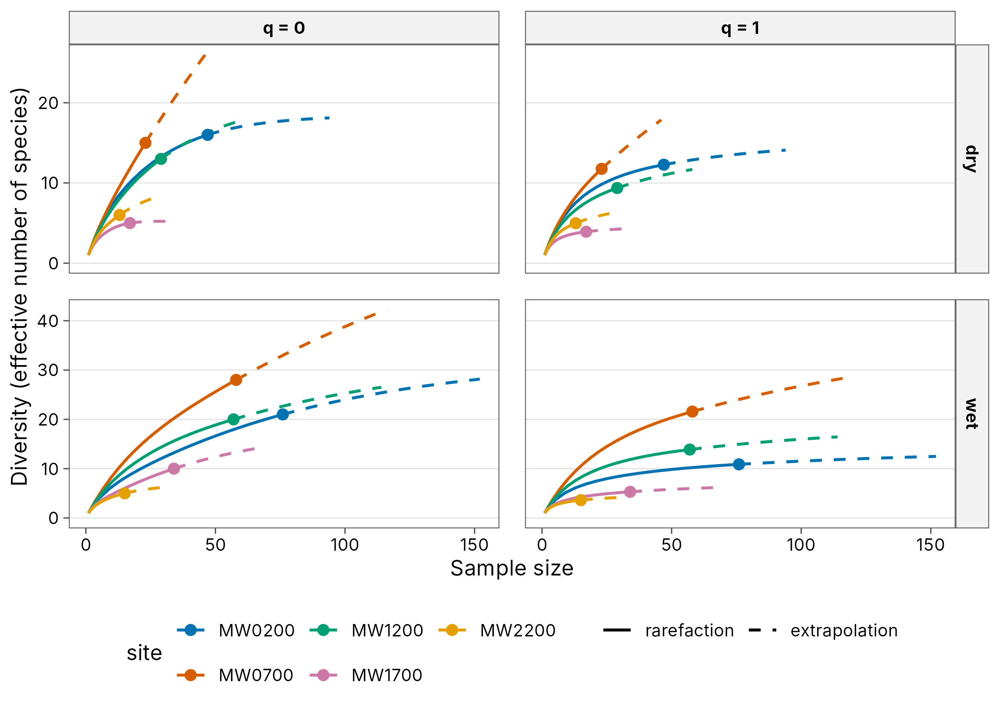
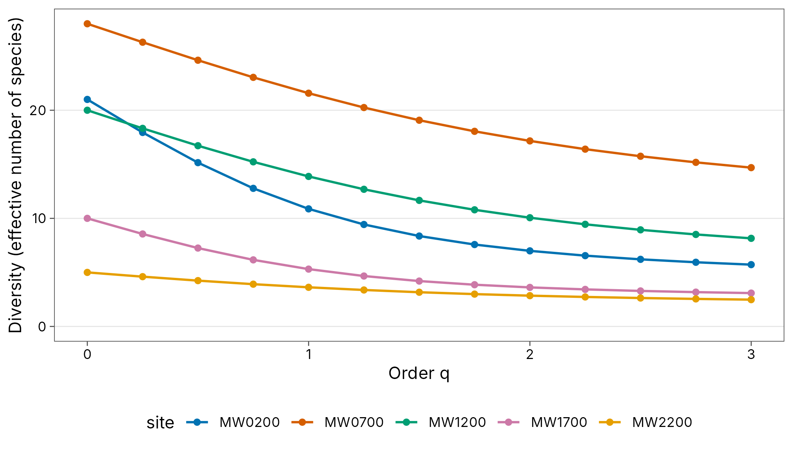
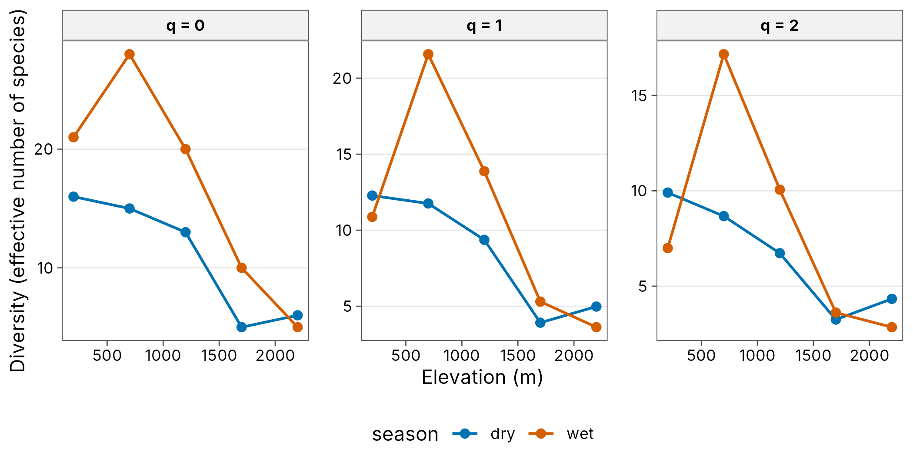
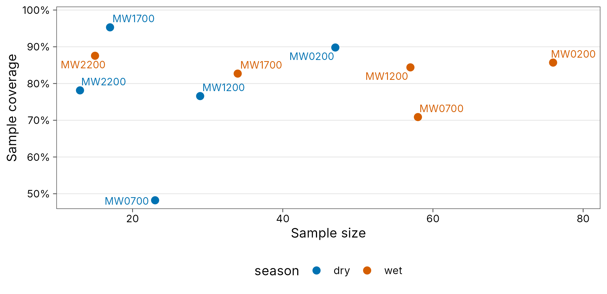
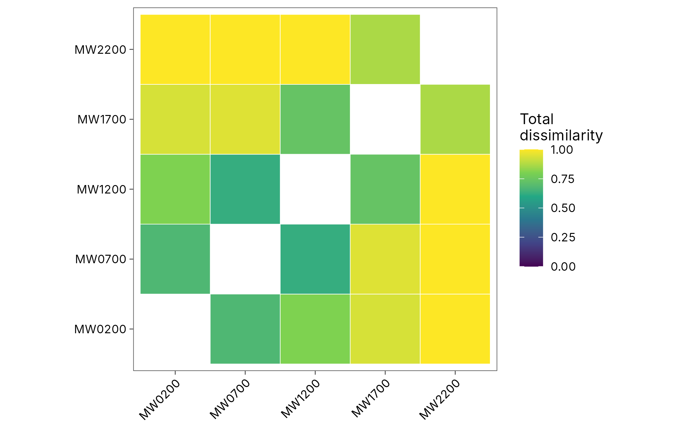
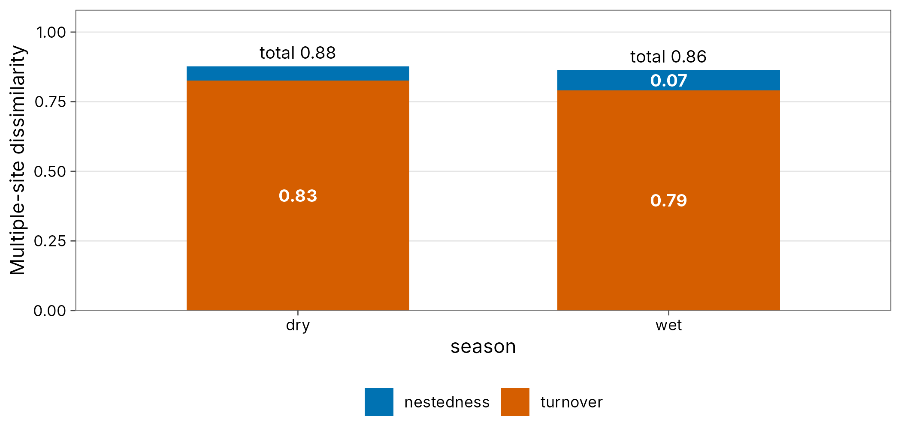
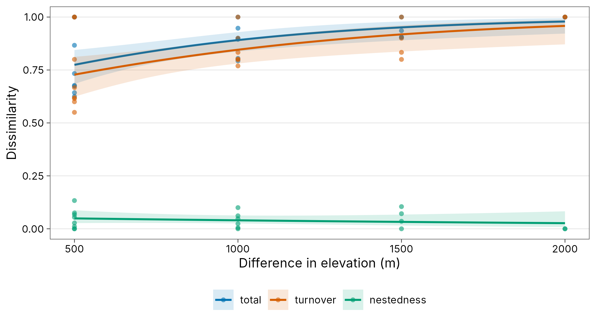
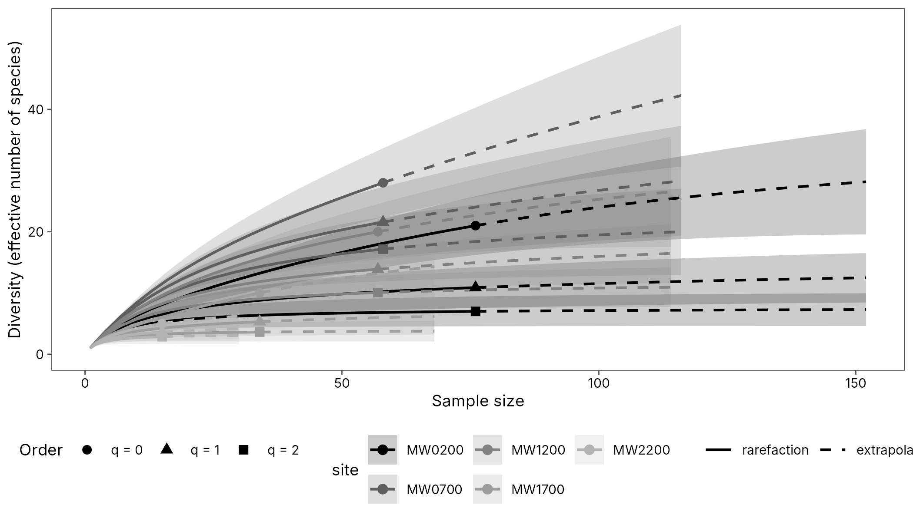

# Gallery

Every plot that
[`autoplot()`](https://rdrr.io/pkg/ggplot2/man/autoplot.html) draws,
using `png_ants`: real ant bait data from the Mt Wilhelm elevational
gradient, Papua New Guinea. Each entry has three tabs: the plot, the
tidy table behind it, and the code. All plots use the colour-blind-safe
Okabe-Ito palette and
[`theme_tidydiversity()`](https://tidydiversity.in4metrix.dev/reference/theme_tidydiversity.md)
by default; see the [publication
figures](https://tidydiversity.in4metrix.dev/articles/publication.md)
article for customisation.

Maps are in the companion package tidymapr; see its
[Gallery](https://tidymapr.in4metrix.dev/articles/gallery.html).

``` r
library(tidydiversity)
library(dplyr)
library(ggplot2)
set.seed(1)
wet <- filter(png_ants, season == "wet")
```

## Rarefaction and extrapolation by sample size

- Plot
- Table
- Code


``` r
curves
#> # A tibble: 570 × 8
#>    site       q     m method      diversity coverage lower upper
#>    <chr>  <dbl> <dbl> <chr>           <dbl>    <dbl> <dbl> <dbl>
#>  1 MW0200     0     1 rarefaction      1       0.132  1     1.00
#>  2 MW0200     0     5 rarefaction      3.92    0.445  3.57  4.27
#>  3 MW0200     0     9 rarefaction      5.90    0.585  5.14  6.65
#>  4 MW0200     0    13 rarefaction      7.44    0.655  6.34  8.54
#>  5 MW0200     0    17 rarefaction      8.75    0.695  7.37 10.1 
#>  6 MW0200     0    21 rarefaction      9.93    0.721  8.30 11.6 
#>  7 MW0200     0    25 rarefaction     11.0     0.740  9.16 12.9 
#>  8 MW0200     0    29 rarefaction     12.0     0.754  9.97 14.1 
#>  9 MW0200     0    33 rarefaction     13.0     0.766 10.7  15.3 
#> 10 MW0200     0    38 rarefaction     14.1     0.780 11.7  16.6 
#> # ℹ 560 more rows
```

``` r
curves <- div_rarefy(wet, nboot = 50)
autoplot(curves)
```

## Rarefaction and extrapolation by sample coverage

- Plot
- Table
- Code


``` r
curves
#> # A tibble: 570 × 8
#>    site       q     m method      diversity coverage lower upper
#>    <chr>  <dbl> <dbl> <chr>           <dbl>    <dbl> <dbl> <dbl>
#>  1 MW0200     0     1 rarefaction      1       0.132  1     1.00
#>  2 MW0200     0     5 rarefaction      3.92    0.445  3.56  4.28
#>  3 MW0200     0     9 rarefaction      5.90    0.585  5.09  6.70
#>  4 MW0200     0    13 rarefaction      7.44    0.655  6.24  8.64
#>  5 MW0200     0    17 rarefaction      8.75    0.695  7.20 10.3 
#>  6 MW0200     0    21 rarefaction      9.93    0.721  8.07 11.8 
#>  7 MW0200     0    25 rarefaction     11.0     0.740  8.88 13.2 
#>  8 MW0200     0    29 rarefaction     12.0     0.754  9.64 14.4 
#>  9 MW0200     0    33 rarefaction     13.0     0.766 10.4  15.6 
#> 10 MW0200     0    38 rarefaction     14.1     0.780 11.2  17.1 
#> # ℹ 560 more rows
```

``` r
curves <- div_rarefy(wet, nboot = 50)
autoplot(curves, x = "coverage")
```

## Curves for several groups

- Plot
- Table
- Code



``` r
grouped
#> # A tibble: 740 × 9
#>    season site       q     m method      diversity coverage lower upper
#>    <chr>  <chr>  <dbl> <dbl> <chr>           <dbl>    <dbl> <dbl> <dbl>
#>  1 dry    MW0200     0     1 rarefaction      1      0.0814    NA    NA
#>  2 dry    MW0200     0     3 rarefaction      2.76   0.220     NA    NA
#>  3 dry    MW0200     0     6 rarefaction      4.94   0.377     NA    NA
#>  4 dry    MW0200     0     8 rarefaction      6.14   0.457     NA    NA
#>  5 dry    MW0200     0    11 rarefaction      7.67   0.549     NA    NA
#>  6 dry    MW0200     0    13 rarefaction      8.55   0.596     NA    NA
#>  7 dry    MW0200     0    16 rarefaction      9.70   0.652     NA    NA
#>  8 dry    MW0200     0    18 rarefaction     10.4    0.682     NA    NA
#>  9 dry    MW0200     0    21 rarefaction     11.3    0.720     NA    NA
#> 10 dry    MW0200     0    23 rarefaction     11.8    0.741     NA    NA
#> # ℹ 730 more rows
```

``` r
grouped <- div_rarefy(png_ants, q = c(0, 1), .by = season)
autoplot(grouped)
```

## Diversity at equal coverage

- Plot
- Table
- Code


``` r
std
#> # A tibble: 30 × 10
#>    season site       q     m method        coverage diversity    se lower upper
#>    <chr>  <chr>  <dbl> <dbl> <chr>            <dbl>     <dbl> <dbl> <dbl> <dbl>
#>  1 dry    MW0200     0  11.6 rarefaction      0.565      7.96 0.510  6.96  8.96
#>  2 dry    MW0200     1  11.6 rarefaction      0.565      7.10 0.577  5.97  8.23
#>  3 dry    MW0200     2  11.6 rarefaction      0.565      6.24 0.596  5.07  7.40
#>  4 wet    MW0200     0  45.1 rarefaction      0.796     15.7  1.54  12.6  18.7 
#>  5 wet    MW0200     1  45.1 rarefaction      0.796      9.57 1.27   7.08 12.1 
#>  6 wet    MW0200     2  45.1 rarefaction      0.796      6.63 0.985  4.70  8.56
#>  7 dry    MW0700     0  46.0 extrapolation    0.565     26.0  4.12  17.9  34.1 
#>  8 dry    MW0700     1  46.0 extrapolation    0.565     17.9  3.95  10.1  25.6 
#>  9 dry    MW0700     2  46.0 extrapolation    0.565     10.5  3.16   4.30 16.7 
#> 10 wet    MW0700     0 116   extrapolation    0.796     42.2  6.20  30.1  54.4 
#> # ℹ 20 more rows
```

``` r
std <- div_standardise(png_ants, .by = season, nboot = 50)
autoplot(std)
```

## Observed and asymptotic diversity

- Plot
- Table
- Code


``` r
est
#> # A tibble: 15 × 7
#>    site       q observed estimate     se lower  upper
#>    <chr>  <dbl>    <dbl>    <dbl>  <dbl> <dbl>  <dbl>
#>  1 MW0200     0    21       32.9  10.5   23.7   73.7 
#>  2 MW0200     1    10.9     13.8   2.40  10.9   18.5 
#>  3 MW0200     2     6.99     7.6   1.33   6.99  10.2 
#>  4 MW0700     0    28       75.3  38.8   39.6  221.  
#>  5 MW0700     1    21.6     38.8   7.31  24.5   53.1 
#>  6 MW0700     2    17.2     24.0   4.12  17.2   32.0 
#>  7 MW1200     0    20       33.3  14.3   22.4   94.4 
#>  8 MW1200     1    13.9     18.8   2.92  13.9   24.6 
#>  9 MW1200     2    10.1     12     2.65  10.1   17.2 
#> 10 MW1700     0    10       18.7   9.94  11.5   62.1 
#> 11 MW1700     1     5.30     7.05  2.28   5.30  11.5 
#> 12 MW1700     2     3.61     3.92  1.21   3.61   6.30
#> 13 MW2200     0     5        6.87  2.69   5.23  19.9 
#> 14 MW2200     1     3.62     4.54  1.30   3.62   7.09
#> 15 MW2200     2     2.85     3.28  0.983  2.85   5.21
```

``` r
est <- div_estimate(wet, nboot = 50)
autoplot(est)
```

## Hill diversity profile

- Plot
- Table
- Code



``` r
profile
#> # A tibble: 65 × 4
#>    site       q     n diversity
#>    <chr>  <dbl> <dbl>     <dbl>
#>  1 MW0200  0       76     21   
#>  2 MW0200  0.25    76     17.9 
#>  3 MW0200  0.5     76     15.2 
#>  4 MW0200  0.75    76     12.8 
#>  5 MW0200  1       76     10.9 
#>  6 MW0200  1.25    76      9.43
#>  7 MW0200  1.5     76      8.36
#>  8 MW0200  1.75    76      7.58
#>  9 MW0200  2       76      6.99
#> 10 MW0200  2.25    76      6.55
#> # ℹ 55 more rows
```

``` r
profile <- div_hill(wet, q = seq(0, 3, by = 0.25))
autoplot(profile)
```

## Diversity along a gradient

- Plot
- Table
- Code



``` r
hill
#> # A tibble: 30 × 6
#>    season elevation site       q     n diversity
#>    <chr>      <int> <chr>  <dbl> <dbl>     <dbl>
#>  1 dry          200 MW0200     0    47     16   
#>  2 dry          200 MW0200     1    47     12.3 
#>  3 dry          200 MW0200     2    47      9.91
#>  4 wet          200 MW0200     0    76     21   
#>  5 wet          200 MW0200     1    76     10.9 
#>  6 wet          200 MW0200     2    76      6.99
#>  7 dry          700 MW0700     0    23     15   
#>  8 dry          700 MW0700     1    23     11.8 
#>  9 dry          700 MW0700     2    23      8.67
#> 10 wet          700 MW0700     0    58     28   
#> # ℹ 20 more rows
```

``` r
hill <- div_hill(png_ants, .by = c(season, elevation))
autoplot(hill, gradient = elevation, xlab = "Elevation (m)")
```

## Sample coverage

- Plot
- Table
- Code



``` r
cov
#> # A tibble: 10 × 7
#>    season site       n s_obs    f1    f2 coverage
#>    <chr>  <chr>  <dbl> <int> <int> <int>    <dbl>
#>  1 dry    MW0200    47    16     5     5    0.898
#>  2 wet    MW0200    76    21    11     5    0.857
#>  3 dry    MW0700    23    15    12     1    0.482
#>  4 wet    MW0700    58    28    17     3    0.709
#>  5 dry    MW1200    29    13     7     3    0.766
#>  6 wet    MW1200    57    20     9     3    0.844
#>  7 dry    MW1700    17     5     1     2    0.953
#>  8 wet    MW1700    34    10     6     2    0.827
#>  9 dry    MW2200    13     6     3     1    0.781
#> 10 wet    MW2200    15     5     2     1    0.876
```

``` r
cov <- div_coverage(png_ants, .by = season)
autoplot(cov)
```

## Pairwise beta diversity heatmap

- Plot
- Table
- Code



``` r
pair
#> # A tibble: 10 × 5
#>    site_1 site_2 turnover nestedness total
#>    <chr>  <chr>     <dbl>      <dbl> <dbl>
#>  1 MW0200 MW0700    0.619    0.0544  0.673
#>  2 MW0200 MW1200    0.8      0.00488 0.805
#>  3 MW0200 MW1700    0.9      0.0355  0.935
#>  4 MW0200 MW2200    1        0       1    
#>  5 MW0700 MW1200    0.55     0.075   0.625
#>  6 MW0700 MW1700    0.9      0.0474  0.947
#>  7 MW0700 MW2200    1        0       1    
#>  8 MW1200 MW1700    0.6      0.133   0.733
#>  9 MW1200 MW2200    1        0       1    
#> 10 MW1700 MW2200    0.8      0.0667  0.867
```

``` r
pair <- beta_pair(wet)
autoplot(pair)
```

## Multiple-site beta partition

- Plot
- Table
- Code



``` r
multi
#> # A tibble: 2 × 5
#>   season n_sites turnover nestedness total
#>   <chr>    <int>    <dbl>      <dbl> <dbl>
#> 1 dry          5    0.827     0.0507 0.877
#> 2 wet          5    0.790     0.0737 0.864
```

``` r
multi <- beta_multi(png_ants, .by = season)
autoplot(multi)
```

## Distance decay

- Plot
- Table
- Model
- Code



``` r
decay
#> # A tibble: 20 × 9
#>    season site_1 site_2 turnover nestedness total gradient_1 gradient_2 distance
#>    <chr>  <chr>  <chr>     <dbl>      <dbl> <dbl>      <int>      <int>    <dbl>
#>  1 dry    MW0200 MW0700    0.667    0.0108  0.677        200        700      500
#>  2 dry    MW0200 MW1200    0.769    0.0239  0.793        200       1200     1000
#>  3 dry    MW0200 MW1700    0.8      0.105   0.905        200       1700     1500
#>  4 dry    MW0200 MW2200    1        0       1            200       2200     2000
#>  5 dry    MW0700 MW1200    0.615    0.0275  0.643        700       1200      500
#>  6 dry    MW0700 MW1700    0.8      0.1     0.9          700       1700     1000
#>  7 dry    MW0700 MW2200    0.833    0.0714  0.905        700       2200     1500
#>  8 dry    MW1200 MW1700    1        0       1           1200       1700      500
#>  9 dry    MW1200 MW2200    0.833    0.0614  0.895       1200       2200     1000
#> 10 dry    MW1700 MW2200    1        0       1           1700       2200      500
#> 11 wet    MW0200 MW0700    0.619    0.0544  0.673        200        700      500
#> 12 wet    MW0200 MW1200    0.8      0.00488 0.805        200       1200     1000
#> 13 wet    MW0200 MW1700    0.9      0.0355  0.935        200       1700     1500
#> 14 wet    MW0200 MW2200    1        0       1            200       2200     2000
#> 15 wet    MW0700 MW1200    0.55     0.075   0.625        700       1200      500
#> 16 wet    MW0700 MW1700    0.9      0.0474  0.947        700       1700     1000
#> 17 wet    MW0700 MW2200    1        0       1            700       2200     1500
#> 18 wet    MW1200 MW1700    0.6      0.133   0.733       1200       1700      500
#> 19 wet    MW1200 MW2200    1        0       1           1200       2200     1000
#> 20 wet    MW1700 MW2200    0.8      0.0667  0.867       1700       2200      500
```

``` r
set.seed(1)
beta_decay_model(decay)
#> # A tibble: 2 × 10
#>   season model    component n_pairs     a       b half_distance pseudo_r2    aic
#>   <chr>  <chr>    <chr>       <int> <dbl>   <dbl>         <dbl>     <dbl>  <dbl>
#> 1 dry    exponen… total          10 0.257 7.50e-4          924.     0.143  -9.21
#> 2 wet    exponen… total          10 0.897 2.36e-3          293.     0.694 -17.6 
#> # ℹ 1 more variable: p.value <dbl>
```

``` r
decay <- beta_decay(png_ants, elevation, .by = season)
autoplot(decay, xlab = "Difference in elevation (m)")
beta_decay_model(decay)
```

## Pairwise Hill dissimilarity

- Plot
- Table
- Code


``` r
hp
#> # A tibble: 30 × 10
#>    site_1 site_2     q gamma alpha  beta dis_sorensen dis_jaccard
#>    <chr>  <chr>  <dbl> <dbl> <dbl> <dbl>        <dbl>       <dbl>
#>  1 MW0200 MW0700     0    41  24.5  1.67        0.673       0.805
#>  2 MW0200 MW1200     0    37  20.5  1.80        0.805       0.892
#>  3 MW0200 MW1700     0    30  15.5  1.94        0.935       0.967
#>  4 MW0200 MW2200     0    26  13    2           1           1    
#>  5 MW0700 MW1200     0    39  24    1.62        0.625       0.769
#>  6 MW0700 MW1700     0    37  19    1.95        0.947       0.973
#>  7 MW0700 MW2200     0    33  16.5  2           1           1    
#>  8 MW1200 MW1700     0    26  15    1.73        0.733       0.846
#>  9 MW1200 MW2200     0    25  12.5  2           1           1    
#> 10 MW1700 MW2200     0    14   7.5  1.87        0.867       0.929
#> # ℹ 20 more rows
#> # ℹ 2 more variables: dis_turnover_sorensen <dbl>, dis_turnover_jaccard <dbl>
```

``` r
wet <- dplyr::filter(png_ants, season == "wet")
hp <- beta_hill_pair(wet, abundance = workers)
autoplot(hp)
```

## Coverage-standardised beta diversity

- Plot
- Table
- Code


``` r
hb[c("season", "q", "gamma", "alpha", "beta", "beta_lower", "beta_upper")]
#> # A tibble: 6 × 7
#>   season     q gamma alpha  beta beta_lower beta_upper
#>   <chr>  <dbl> <dbl> <dbl> <dbl>      <dbl>      <dbl>
#> 1 dry        0  44.4 14.5   3.06       2.31       3.82
#> 2 dry        1  31.0  9.93  3.12       2.61       3.64
#> 3 dry        2  23.3  6.97  3.35       2.89       3.81
#> 4 wet        0  64.1 23.5   2.73       2.11       3.34
#> 5 wet        1  35.4 12.3   2.86       2.46       3.27
#> 6 wet        2  21.4  7.08  3.02       2.52       3.52
```

``` r
hb <- beta_hill(png_ants, coverage = 0.9, nboot = 50, .by = season)
autoplot(hb)
autoplot(hb, what = "dissimilarity")
```

## Greyscale for print

- Plot
- Table
- Code



``` r
curves
#> # A tibble: 570 × 8
#>    site       q     m method      diversity coverage lower upper
#>    <chr>  <dbl> <dbl> <chr>           <dbl>    <dbl> <dbl> <dbl>
#>  1 MW0200     0     1 rarefaction      1       0.132  1     1.00
#>  2 MW0200     0     5 rarefaction      3.92    0.445  3.56  4.28
#>  3 MW0200     0     9 rarefaction      5.90    0.585  5.09  6.70
#>  4 MW0200     0    13 rarefaction      7.44    0.655  6.24  8.64
#>  5 MW0200     0    17 rarefaction      8.75    0.695  7.20 10.3 
#>  6 MW0200     0    21 rarefaction      9.93    0.721  8.07 11.8 
#>  7 MW0200     0    25 rarefaction     11.0     0.740  8.88 13.2 
#>  8 MW0200     0    29 rarefaction     12.0     0.754  9.64 14.4 
#>  9 MW0200     0    33 rarefaction     13.0     0.766 10.4  15.6 
#> 10 MW0200     0    38 rarefaction     14.1     0.780 11.2  17.1 
#> # ℹ 560 more rows
```

``` r
autoplot(curves, palette = "grey", facet = FALSE,
  theme = theme_tidydiversity(base_size = 9, grid = "none"))
```

## Ordination triplot

An RDA of the Wanang butterflies constrained by year and month: sites,
the ten best-fitting species (red arrows), the month gradient (dark
arrow), year centroids and ellipses for each year.

- Plot
- Code


``` r
butterflies <- mutate(wanang_butterflies, year = factor(paste("Year", year)))
rda <- ord_fit(butterflies, method = "rda", formula = ~ year + month)
autoplot(rda, colour = year, ellipse = "sd", species = 10)
```

## Shared species: Venn diagram

[`plot_venn()`](https://tidydiversity.in4metrix.dev/reference/plot_venn.md)
counts the species found in each combination of two to four groups.
Here, ant species at four elevations on Mt Wilhelm.

- Plot
- Two groups
- Code


``` r
plot_venn(filter(png_ants, elevation %in% c(200, 700, 1200, 1700)), group = elevation)
plot_venn(wanang_caterpillars, group = site)
```

## Phylogenetic diversity

[`plot_phylo()`](https://tidydiversity.in4metrix.dev/reference/plot_phylo.md)
draws the tree with each species’ relative abundance per site. The
coloured branches lead to the frogs found at 200 m: their total length
is Faith’s PD for that site. The tree here is a taxonomic tree (family,
genus, species) with Grafen branch lengths; use a dated phylogeny where
one exists.

- Plot
- Code


``` r
frogs <- mutate(png_frogs,
  genus = sub(" .*", "", scientific_name),
  tip = gsub(" ", "_", scientific_name)
)
tax <- distinct(as.data.frame(frogs[c("family", "genus", "tip")]))
tax[] <- lapply(tax, factor)
tree <- ape::compute.brlen(ape::as.phylo(~ family / genus / tip, data = tax))
plot_phylo(tree, frogs, species = tip, abundance = abundance, highlight = "MW0200")
```

## Functional trait space

[`plot_trait_space()`](https://tidydiversity.in4metrix.dev/reference/plot_trait_space.md)
places the alpine plants of the `aravo` data in a PCoA of Gower trait
distances. Each hull encloses the species found under one level of
zoogenic disturbance (its area is the two-dimensional functional
richness) and the diamonds are cover-weighted mean positions.

- Plot
- Code


``` r
aravo <- data_aravo()
plot_trait_space(aravo$traits, aravo$community, group = ZoogD, abundance = cover)
```

## Maps

Maps are drawn by the companion package
[tidymapr](https://gitlab.com/jimmy.moses/tidymapr), which takes the
same tidy tables. Its
[Gallery](https://tidymapr.in4metrix.dev/articles/gallery.html) shows
study-site, Hill-number, elevation and species distribution maps from
real, published records.
