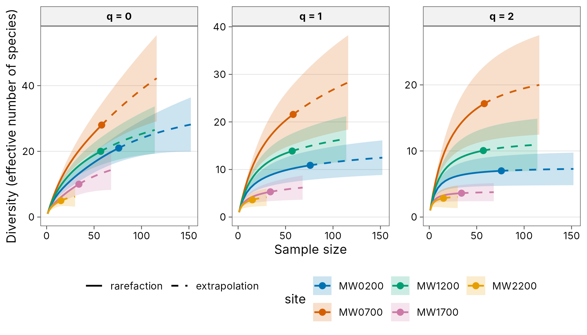
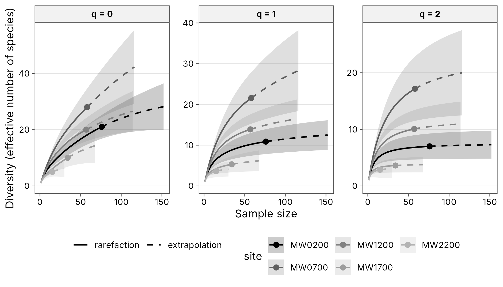

# Publication figures and tables

Every [`autoplot()`](https://rdrr.io/pkg/ggplot2/man/autoplot.html)
method returns an ordinary ggplot, so anything can be changed with `+`.
The common changes for a journal figure are built in.

``` r
library(tidydiversity)
library(dplyr)
library(ggplot2)
set.seed(1)
wet <- filter(png_ants, season == "wet")
curves <- div_rarefy(wet, nboot = 100)
```

## Plot options

- Default
- Labels and facets
- Greyscale
- Own colours
- One panel

Okabe-Ito colours, solid rarefaction and dashed extrapolation, 95%
bootstrap ribbons and the publication theme.

``` r
autoplot(curves)
```



``` r
autoplot(filter(curves, q == 0),
  xlab = "Number of ant workers",
  ylab = "Species richness", ncol = 2, scales = "fixed"
)
```


`palette = "grey"` is for print journals; line type still separates
rarefaction and extrapolation.

``` r
autoplot(curves, palette = "grey")
```



Pass a vector of colours, or `theme = NULL` to start from the ggplot2
default and add your own theme.

``` r
autoplot(curves,
  palette = hcl.colors(8, "Dark 3"), ci = FALSE,
  theme = NULL
) +
  theme_classic(base_size = 10) +
  theme(legend.position = "right")
```


``` r
autoplot(div_rarefy(filter(wet, site == "MW0200"), nboot = 100),
  facet = FALSE
)
```


## The publication theme

[`theme_tidydiversity()`](https://tidydiversity.in4metrix.dev/reference/theme_tidydiversity.md)
has a white background, light horizontal grid, bold strip labels and the
legend at the bottom. It takes `base_size`, `base_family`,
`legend_position` and `grid` (`"y"`, `"xy"` or `"none"`). The palettes
are also available as ggplot2 scales.

``` r
div_hill(png_ants, .by = c(season, elevation)) |>
  filter(q == 1) |>
  ggplot(aes(elevation, diversity, colour = season)) +
  geom_line() +
  geom_point() +
  scale_colour_tidydiversity() +
  labs(x = "Elevation (m)", y = "Shannon diversity") +
  theme_tidydiversity(base_size = 12, grid = "xy")
```


## Tables

[`div_table()`](https://tidydiversity.in4metrix.dev/reference/div_table.md)
formats any result with the estimate and an APA-style interval, for
example `12.3 [9.8, 15.1]`, and renders it as a tibble, **knitr** kable,
**gt** table or **flextable** (for Word).

- Long
- Wide
- gt
- flextable (Word)

``` r
est <- div_estimate(wet, nboot = 100)
div_table(est,
  digits = 1, output = "kable",
  caption = "Asymptotic diversity, wet season"
)
```

| site   | Order q | Observed |  Estimate \[95% CI\] |
|:-------|--------:|---------:|---------------------:|
| MW0200 |       0 |     21.0 |  32.9 \[23.0, 90.9\] |
| MW0200 |       1 |     10.9 |  13.8 \[10.9, 17.9\] |
| MW0200 |       2 |      7.0 |     7.6 \[7.0, 9.7\] |
| MW0700 |       0 |     28.0 | 75.3 \[40.2, 211.3\] |
| MW0700 |       1 |     21.6 |  38.8 \[22.2, 55.4\] |
| MW0700 |       2 |     17.2 |  24.0 \[17.2, 33.7\] |
| MW1200 |       0 |     20.0 |  33.3 \[22.4, 94.4\] |
| MW1200 |       1 |     13.9 |  18.8 \[13.9, 25.3\] |
| MW1200 |       2 |     10.1 |  12.0 \[10.1, 17.0\] |
| MW1700 |       0 |     10.0 |  18.7 \[11.4, 63.3\] |
| MW1700 |       1 |      5.3 |    7.0 \[5.3, 11.2\] |
| MW1700 |       2 |      3.6 |     3.9 \[3.6, 5.9\] |
| MW2200 |       0 |      5.0 |    6.9 \[5.3, 18.9\] |
| MW2200 |       1 |      3.6 |     4.5 \[3.6, 7.3\] |
| MW2200 |       2 |      2.8 |     3.3 \[2.8, 5.8\] |

Asymptotic diversity, wet season

``` r
div_table(est, digits = 1, wide = TRUE, output = "kable")
```

| site   | observed (q = 0) |     estimate (q = 0) | observed (q = 1) |    estimate (q = 1) | observed (q = 2) |    estimate (q = 2) |
|:-------|-----------------:|---------------------:|-----------------:|--------------------:|-----------------:|--------------------:|
| MW0200 |             21.0 |  32.9 \[23.0, 90.9\] |             10.9 | 13.8 \[10.9, 17.9\] |              7.0 |    7.6 \[7.0, 9.7\] |
| MW0700 |             28.0 | 75.3 \[40.2, 211.3\] |             21.6 | 38.8 \[22.2, 55.4\] |             17.2 | 24.0 \[17.2, 33.7\] |
| MW1200 |             20.0 |  33.3 \[22.4, 94.4\] |             13.9 | 18.8 \[13.9, 25.3\] |             10.1 | 12.0 \[10.1, 17.0\] |
| MW1700 |             10.0 |  18.7 \[11.4, 63.3\] |              5.3 |   7.0 \[5.3, 11.2\] |              3.6 |    3.9 \[3.6, 5.9\] |
| MW2200 |              5.0 |    6.9 \[5.3, 18.9\] |              3.6 |    4.5 \[3.6, 7.3\] |              2.8 |    3.3 \[2.8, 5.8\] |

``` r
div_table(est,
  digits = 1, wide = TRUE, output = "gt",
  caption = "Asymptotic diversity"
)
```

| Asymptotic diversity |                  |                      |                  |                     |                  |                     |
|----------------------|------------------|----------------------|------------------|---------------------|------------------|---------------------|
| site                 | observed (q = 0) | estimate (q = 0)     | observed (q = 1) | estimate (q = 1)    | observed (q = 2) | estimate (q = 2)    |
| MW0200               | 21.0             | 32.9 \[23.0, 90.9\]  | 10.9             | 13.8 \[10.9, 17.9\] | 7.0              | 7.6 \[7.0, 9.7\]    |
| MW0700               | 28.0             | 75.3 \[40.2, 211.3\] | 21.6             | 38.8 \[22.2, 55.4\] | 17.2             | 24.0 \[17.2, 33.7\] |
| MW1200               | 20.0             | 33.3 \[22.4, 94.4\]  | 13.9             | 18.8 \[13.9, 25.3\] | 10.1             | 12.0 \[10.1, 17.0\] |
| MW1700               | 10.0             | 18.7 \[11.4, 63.3\]  | 5.3              | 7.0 \[5.3, 11.2\]   | 3.6              | 3.9 \[3.6, 5.9\]    |
| MW2200               | 5.0              | 6.9 \[5.3, 18.9\]    | 3.6              | 4.5 \[3.6, 7.3\]    | 2.8              | 3.3 \[2.8, 5.8\]    |

``` r
ft <- div_table(est,
  digits = 1, ci_style = "parentheses",
  output = "flextable"
)
ft
```

| site   | Order q | Observed | Estimate (95% CI) |
|--------|---------|----------|-------------------|
| MW0200 | 0       | 21.0     | 32.9 (23.0-90.9)  |
| MW0200 | 1       | 10.9     | 13.8 (10.9-17.9)  |
| MW0200 | 2       | 7.0      | 7.6 (7.0-9.7)     |
| MW0700 | 0       | 28.0     | 75.3 (40.2-211.3) |
| MW0700 | 1       | 21.6     | 38.8 (22.2-55.4)  |
| MW0700 | 2       | 17.2     | 24.0 (17.2-33.7)  |
| MW1200 | 0       | 20.0     | 33.3 (22.4-94.4)  |
| MW1200 | 1       | 13.9     | 18.8 (13.9-25.3)  |
| MW1200 | 2       | 10.1     | 12.0 (10.1-17.0)  |
| MW1700 | 0       | 10.0     | 18.7 (11.4-63.3)  |
| MW1700 | 1       | 5.3      | 7.0 (5.3-11.2)    |
| MW1700 | 2       | 3.6      | 3.9 (3.6-5.9)     |
| MW2200 | 0       | 5.0      | 6.9 (5.3-18.9)    |
| MW2200 | 1       | 3.6      | 4.5 (3.6-7.3)     |
| MW2200 | 2       | 2.8      | 3.3 (2.8-5.8)     |

Save it to Word with
`flextable::save_as_docx(ft, path = "table1.docx")`.

## Saving figures

Journals usually ask for a set width (single column about 85 mm, double
column about 175 mm) and 300 dpi or more for raster images, or a vector
format such as PDF or EPS.

``` r
p <- autoplot(curves, theme = theme_tidydiversity(base_size = 8))

# Single column, 300 dpi TIFF with LZW compression
ggsave("figure1.tiff", p,
  width = 85, height = 70, units = "mm",
  dpi = 300, compression = "lzw"
)

# Double column, vector PDF (embed fonts with cairo)
ggsave("figure1.pdf", p,
  width = 175, height = 90, units = "mm",
  device = cairo_pdf
)

# High-resolution PNG for slides or preprints
ggsave("figure1.png", p,
  width = 175, height = 90, units = "mm",
  dpi = 600, bg = "white"
)
```

Set `base_size` to the font size the journal asks for (often 8 to 10 pt)
because ggsave does not rescale text when the figure is made smaller.
